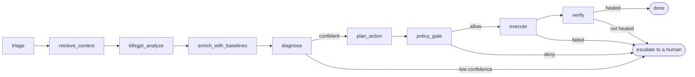

# Keos

Keos is an autonomous SRE and security agent for edge Kubernetes. It detects an
incident, diagnoses it with a local LLM, remediates it through a policy gate,
verifies the fix and records every step in a signed audit log. Everything runs
inside the cluster, with no cloud round-trip.

**The code, docs and install instructions live in [`sre-agent/`](sre-agent/).**
Start with [`sre-agent/README.md`](sre-agent/README.md).

## The stack

| Layer | Built with | Role |
|---|---|---|
| State machine | [LangGraph](https://github.com/langchain-ai/langgraph) `StateGraph` | A fixed graph of nodes and conditional edges, run once per incident |
| State and schemas | Python `TypedDict` + Pydantic | One `IncidentState` flows through the graph; every LLM answer is schema-validated |
| LLM | [Ollama](https://ollama.com), `qwen2.5:3b` by default | Local inference, JSON output; an invalid answer is retried once, then escalated |
| Context | [Qdrant](https://qdrant.tech) RAG, [K8sGPT](https://k8sgpt.ai), metric baselines | Runbooks, live cluster findings and deviation from normal, given to the LLM |
| Events | NATS JetStream | Observers publish Kubernetes, Falco and Tetragon events; the agent consumes them |
| Policy | [Open Policy Agent](https://www.openpolicyagent.org) (Rego) | A severity × action matrix decides what may run; unreachable OPA means deny |
| Actions | MCP server (FastMCP) + Kubernetes client | Executes the approved action on the cluster, after checking the policy a second time |
| API and UI | FastAPI + React | Incidents, approvals, mode switch, audit |

### LangGraph, without LangChain agents

Keos uses LangGraph for the state machine only. There are no LangChain chains,
agents or tool-calling loops; `langchain-core` is installed only because
LangGraph depends on it. LLM calls are plain HTTP requests to Ollama, and the
model is asked two things: what is wrong, and which action from a fixed catalog
would fix it. It never picks the next step and never touches the cluster.

### Python owns the state logic

Each node is a Python function that takes the state and returns a partial
update. Each branch is a Python function with ordinary `if` statements. That is
what makes the agent usable in critical environments:

- **Deterministic flow.** The path through the graph is code that can be read,
  reviewed and unit-tested. The LLM only fills in the diagnosis and the proposal.
- **Fails closed.** An unknown action, an unreachable policy engine, invalid LLM
  output or a failed action all end in escalation, never in a guess.
- **Verified.** After acting, the agent checks that the workload is healthy
  again. If not, it escalates.
- **Audited.** Every node writes a record to an append-only, HMAC-signed audit log.

The graph is defined in [`sre-agent/agent/graph.py`](sre-agent/agent/graph.py)
and the policy in [`sre-agent/policies/agent.rego`](sre-agent/policies/agent.rego).

## Autonomy, with a human in the loop when you want one

How much the agent does on its own is set by three controls, not by the LLM:

1. **Mode**, a cluster resource that can be switched live. `observe-only` (the
   default) diagnoses and proposes but executes nothing. `active` executes what
   the policy allows. `frozen` is the kill switch: nothing executes.
2. **Policy matrix.** Each action has a level from 1 to 4 per severity. Levels 1
   and 2 run autonomously. Levels 3 and 4 are denied: a human is paged and the
   proposed action waits in an approval queue, where an operator approves or
   denies it in the UI. An approved action still goes through the MCP server and
   the policy check, and is marked as a human override in the audit log.
3. **Confidence threshold.** A diagnosis below the threshold (0.6 by default,
   tunable per rule) is escalated instead of acted on.

For example, restarting a pod is autonomous at any severity, draining a node is
autonomous only at high or critical severity, and isolating a pod on a weak
security signal always goes to a human first. `kube-system` and `kube-public`
are never touched.

## Learn more

- [Architecture](sre-agent/docs/ARCHITECTURE.md)
- [Installation](sre-agent/docs/INSTALLATION.md)
- [User and operator guide](sre-agent/docs/USER_GUIDE.md)
- [Security domain](sre-agent/docs/SECURITY.md)
