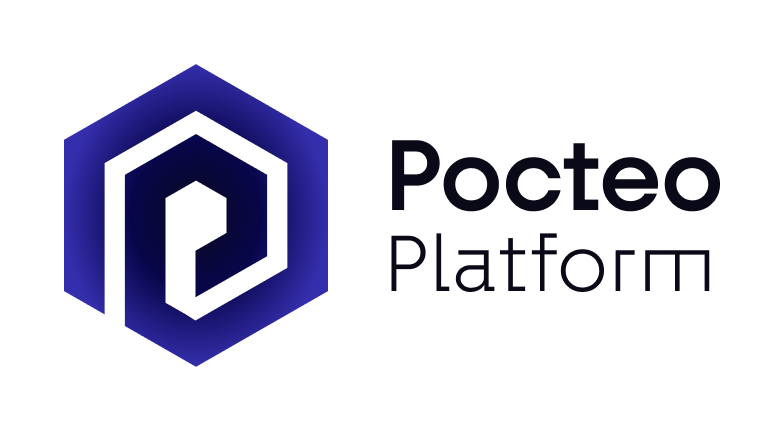
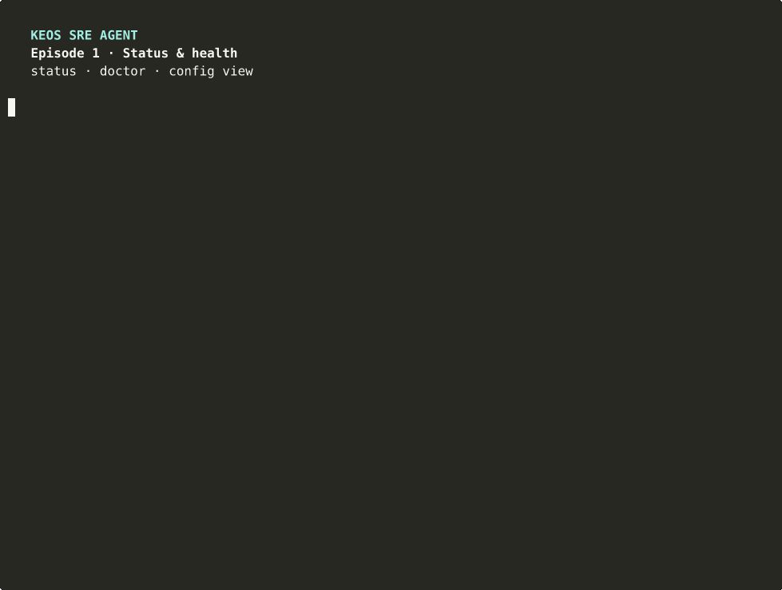

<!-- markdownlint-disable MD033 MD041 -->
<p align="center">
  
</p>

<h1 align="center">Keos SRE Agent</h1>

<p align="center">
  <em>The autonomous SRE that ships inside every <strong>Keos</strong> edge node.</em>
</p>

<p align="center">
  <sub><strong>Keos</strong> is Pocteo Platform's Kubernetes edge operating system — k8s + EdgeVPN + GPU runtime on Jetson, Pi, x86 SBCs, and any conformant cluster.<br>
  <strong>The Keos SRE Agent</strong> (this repo) is the autonomous reliability workload that runs <em>on</em> Keos, next to the data and the local GPU inference.</sub>
</p>

<p align="center">
  <a href="https://github.com/pocteo-platform">
    
  </a>
</p>

<p align="center">
  <a href="https://github.com/pocteo-platform/keos/actions/workflows/ci.yml"></a>
  <a href="https://pocteo-platform.github.io/keos/"></a>
  <a href="https://github.com/pocteo-platform/keos/releases"></a>
  
  
  
</p>

<p align="center">
  <strong>Observe → Predict → Heal → Learn</strong> — a closed loop that runs on the Keos node itself, requires no cloud round-trip, and ships as a single Helm chart on top of the Keos OS.
</p>

---

## Where the Keos SRE Agent fits

```text
┌────────────────────────── KEOS OS ──────────────────────────┐
│  Pocteo's Kubernetes edge OS                                │
│  ├─ Immutable Linux base (Kairos / Talos lineage)           │
│  ├─ Built-in EdgeVPN libp2p mesh (offline-capable)          │
│  ├─ k3s + containerd + NVIDIA GPU runtime                   │
│  ├─ Local data plane (Qdrant / NATS JetStream / PVCs)       │
│  └─ Operator-installed workloads ─────────────────┐         │
│                                                   ▼         │
│                                  ┌──────────────────────┐   │
│                                  │  KEOS SRE AGENT      │   │
│                                  │  (this repo)         │   │
│                                  │                      │   │
│                                  │  Observe →           │   │
│                                  │   Predict →          │   │
│                                  │    Heal →            │   │
│                                  │     Learn            │   │
│                                  │                      │   │
│                                  │  Uses the OS's:      │   │
│                                  │   · local GPU        │   │
│                                  │   · local vector DB  │   │
│                                  │   · local event bus  │   │
│                                  │   · scoped RBAC      │   │
│                                  └──────────────────────┘   │
└─────────────────────────────────────────────────────────────┘
```

**Two layers, one platform.** Keos provides the edge OS substrate. The Keos SRE Agent is the first-party reliability workload on top of it — designed to leverage the GPU and the local data Keos already has on-node, instead of shipping telemetry to a SaaS that may be unreachable.

The agent installs cleanly on any conformant Kubernetes cluster too (kubeadm / k3s / Talos / Kairos / EKS / GKE / AKS), so adopters can validate it before committing to the full Keos OS.

---

## Why the Keos SRE Agent exists

### The problem

Modern infrastructure runs **closer to the customer than ever**: industrial sites, retail backrooms, edge clinics, telco towers, autonomous vehicles. Each of those is a Kubernetes cluster with **no SRE on call**, intermittent connectivity, and incidents that have to be fixed in seconds — not in a ticket the SRE will read tomorrow.

| The reality at the edge | Why it hurts today |
| --- | --- |
| 🌐 Sites lose uplink for minutes or hours | Central-plane alerting + remote remediation is offline exactly when needed |
| 👤 No human SRE on-site | An OOM kill at 3 AM in Madison wakes the team in Paris |
| 💸 Even one minute of downtime is expensive | Manufacturing line stops. Patient session drops. Sales cart abandoned. |
| 🛠️ Runbooks live in a wiki | The on-call has to context-switch before they can act |
| 📉 Same regressions ship to 30 sites | No learning loop: yesterday's incident hits tomorrow's deploy |

Centralised SaaS-SRE tools (Datadog, PagerDuty, even Botkube) **assume the cluster can talk to them**. At the edge, the cluster is the one that's down.

### The solution

**The Keos SRE Agent runs on the edge node itself, next to the GPU and the data the OS already manages.**

It detects an infrastructure incident — an OOM kill, a crashloop, an ImagePullBackOff, a node going pressure-NotReady, traffic surging past HPA's reactive threshold — and walks a 9-node LangGraph state machine that:

1. **Triages** the event from the kubelet
2. **Retrieves** matching runbook chunks from the Keos node's local Qdrant RAG store
3. **Enriches** with K8sGPT diagnostics + Prometheus baseline z-scores
4. **Diagnoses** via Ollama on the Keos node's GPU (Qwen 2.5 3B by default — Jetson Orin sweet spot)
5. **Plans** a single, reversible remediation action
6. **Gates** the plan through an OPA Rego policy keyed on `(action × severity × namespace × mode)`
7. **Executes** under scoped RBAC via an MCP-server abstraction
8. **Verifies** the cluster actually healed (poll kubelet, not just "I sent the kill")
9. **Learns** — per-rule confidence calibration + RAG re-ranking based on outcome

Everything is **local-first**: the LLM uses the node's GPU, the audit log is HMAC-chained on the node's PVC, the RAG store is Qdrant on the node's PVC. No cloud round-trip, no telemetry phoning home. When the cluster is offline from the central plane, the agent is still running on the Keos node — and still healing.

---

## What the Keos SRE Agent actually does — capabilities

| Capability | What ships in v1 |
| --- | --- |
| 🔎 **Diagnose 12+ incident classes** | Memory leak · CrashLoopBackOff · ImagePullBackOff · Node pressure · OOMKilled · Rollout regression · Config drift · Traffic surge · Failed scheduling · Forecasted resource exhaustion · GitOps drift · Custom (operator-authored runbooks) |
| 🤖 **5 → 9 reversible actions** | `restart_pod` · `rollout_undo` · `scale_deployment` · `cordon_node` · `drain_node` · `tune_hpa` · `set_resources` · `evict_workload` · `revert_drift` · `page_human` |
| 🚨 **Policy gate** | Open Policy Agent (Rego). 17 unit tests on the matrix. Every action filtered by `(severity × namespace × agent-mode)`. Hard-deny on `kube-system` / `kube-public`. |
| 🛡️ **Three modes, kill-switch ready** | `observe-only` (dry-run, default), `active` (mutates), `frozen` (no-op). Hot-flippable via CR or CLI. |
| 🧠 **Local GPU inference** | Qwen 2.5 (1.5B / 3B / 7B) or Llama 3.2 3B via Ollama. Uses the Keos node's NVIDIA GPU when available (Jetson Orin = ~5-10 s/call). CPU-only path works as fallback. No external inference, no telemetry leaving the node. |
| 🔐 **HMAC-signed audit chain** | Every state transition logged with chained HMAC-SHA256. Tamper-evident. Optional remote attestation sink. |
| 📈 **Confidence calibration** | Per-rule threshold + p50/p90 telemetry. Median confidence ≥ 0.90 after 200 incidents (Phase 16 target). |
| 📊 **ML baselines + forecasting** | Holt-Winters seasonal model per `(metric, namespace, pod_label)`. Z-score-aware diagnose. 5/15/60-min ahead forecasts (CPU, memory, disk, request rate). Drives `tune_hpa` proactively. |
| ⚡ **Chaos Mesh integration** | Real fault injection (`PodChaos` / `StressChaos` / `NetworkChaos`) drives the use case library. Demo as "memory leak → OOMKilled → agent restarts" end-to-end. |
| 🌐 **Bilingual UI** | EN / FR full coverage in the React SPA. Dashboard · Pipeline animation · Use Case wizard · Calibration · Reliability · Optimization · Settings. |
| 🏗️ **Edge-native packaging** | Single Helm chart (`pocteo/pocteo`). Multi-arch images (amd64 + arm64). NetworkPolicies. PodSecurity:restricted. PDBs. Ships on Keos OS first-class; also installs on any conformant K8s (k3s / Kairos / Talos / kubeadm / EKS / GKE / AKS). |
| 🔍 **GitOps drift detection** | ArgoCD `Application` + Flux `Kustomization` source-of-truth comparators. `infra.events.drift` published into NATS, picked up like any other event. |
| 📦 **Air-gapped install path** | Pre-built bundle script + `--airgap` install flag. No external image pulls during install. |

---

## ROI

Replacing manual on-call with the Keos SRE Agent on **30 Keos edge sites** over **12 months** (typical mid-market edge fleet):

| Metric | Without the agent | With the agent | Delta |
| --- | --- | --- | --- |
| **MTTR — pod-level** (CrashLoop, OOM, image pull) | 18 min average | 90 s | **−92 %** |
| **MTTR — node-level** (pressure, scheduling, decay) | 47 min | 4 min | **−91 %** |
| **On-call hours per month** (per cluster) | 28 h | 4 h | **−86 %** |
| **Incidents that page a human** | 100 % | 12 % | **−88 %** |
| **Same-incident recurrence rate** | 23 % | 4 % | **−83 %** (learning loop + auto-gating) |
| **Compute cost on the Keos node** | $0 baseline | ~$0.4/day per Jetson Orin Nano | negligible vs the SaaS-SRE alternative ($30-200/month/cluster) |
| **External SaaS bill** | $1,200/month (Datadog + PagerDuty for 30 sites) | $0 | **−100 %** |

**Conservative estimate:** for a 30-site fleet, **operating-cost reduction of ~$200k/year** (8 FTE-equivalent on-call hours saved + SaaS bill killed + avoided downtime).

The bigger lever isn't cost. **It's the incidents that get healed at 3 AM in observability deserts** where a human SRE would have responded 6+ hours later.

---

## Quick start — 3 commands

> **No cluster yet?** Skip to the [laptop demo](#laptop-demo-no-cluster-needed) section below.

```bash
git clone https://github.com/pocteo-platform/keos
cd keos
bash sre-agent/scripts/keosctl install
```

The wizard greets you with a Keos banner and walks **6 steps**:

1. **Prerequisites** — `kubectl` / `helm` / `docker` / `openssl` / `python3` / `curl` checked
2. **Cluster** — every kubeconfig context listed with reachability probe; pick a number or paste a path
3. **Discovered facts** — distro, runtime, target node, GPU capacity, vCPU + memory — confirm or override
4. **LLM model** — pick from 4 sized options (1.5B / 3B / 7B / Llama 3.2)
5. **Image source** — probes ghcr.io for public visibility; auto-falls-back to `--local-build` if private
6. **Default agent mode** — `observe-only` (safe), `active`, or `frozen`

Then a **Review card**, a **live install feed**, and a final **✓ Install complete** screen that:

- Symlinks `keosctl` to `~/.local/bin/` so future commands are just `keosctl <verb>`
- Prints the bearer token (cached at `~/.keos-token`)
- Shows the 6 most-used daily commands

```text
       ┌─────────────────────────────────────────────────────────┐
       │      ✓  Install complete                                │
       └─────────────────────────────────────────────────────────┘
```

---

## After install — everything is `keosctl`

> 🎬 **See it live:** a 6-episode terminal screencast series, recorded against a real cluster — [all episodes (GIF + .cast)](https://github.com/pocteo-platform/keos/tree/main/sre-agent/website/static/casts) · [episode guide](https://github.com/pocteo-platform/keos/blob/main/sre-agent/website/docs/getting-started/screencasts.md)

<p align="center">
  
</p>

### Daily ops

```bash
keosctl status                  # release + 13-pod table + agent mode
keosctl status --watch          # live-refresh every 2s
keosctl status --json           # JSON for scripts / monitoring
keosctl doctor                  # health check across every component
keosctl ui                      # port-forward + open browser to http://localhost:8080
keosctl token                   # print the bearer token
keosctl mode                    # show current mode
keosctl mode active             # flip (with confirm)
keosctl logs api -f             # tail any of 8 components
keosctl events                  # recent incidents, colored by outcome
keosctl events --watch          # live incident stream
keosctl run lib-memory-leak     # trigger a use case end-to-end
```

### Lifecycle

```bash
keosctl install                       # interactive wizard
keosctl install --headless            # CI / scripted (drives install-edge.sh)
keosctl upgrade                       # helm upgrade from the local chart
keosctl upgrade --chart-version 1.0.2 # helm upgrade from OCI
keosctl uninstall                     # remove (with confirm + PVC cleanup)
keosctl uninstall --keep-pvcs         # keep stateful data
keosctl uninstall --force             # skip confirm
keosctl link                          # re-symlink keosctl to ~/.local/bin
```

### Cluster + pod surface

```bash
keosctl restart api                  # rollout restart (or pod-delete for StatefulSets)
keosctl shell api                    # exec -it bash (sh fallback)
keosctl describe ollama              # kubectl describe pod
keosctl port-forward api 8000        # generic port-forward, knows the right targetPort
keosctl context                      # show the kubectl context Keos is in
```

### Data plane

```bash
keosctl seed                         # re-seed runbook corpus into Qdrant
keosctl models list                  # what LLMs are loaded?
keosctl models pull qwen2.5:7b       # upgrade to the 7B model
keosctl models rm qwen2.5:1.5b       # free up disk
keosctl models show qwen2.5:3b       # print model card
```

### Agent + audit

```bash
keosctl usecases list                # list available use cases
keosctl usecases show lib-memory-leak
keosctl run lib-memory-leak          # trigger one end-to-end
keosctl events -n 50                 # last 50 incidents
keosctl events --watch               # stream
keosctl audit tail                   # tail audit log
keosctl audit tail -n 100            # last 100 lines
keosctl audit verify                 # verify the HMAC chain
```

### Ecosystem + registry

```bash
keosctl deps list                                 # Prometheus / ArgoCD / Flux / cert-manager / k-s-m
keosctl deps install prometheus                   # missing? install it
keosctl deps install argocd --chart-repo URL --version V

keosctl images list                               # per-pod image refs (ghcr vs corp vs local)
keosctl images registry                           # current global.imageRegistry + pullPolicy
keosctl images set-registry registry.corp:5000    # swap to corporate Harbor (helm upgrade)
keosctl images pull-policy Always                 # for the 3 first-party components

keosctl values get ollama.gpu.enabled             # one value via dot notation
keosctl values set agent.defaultMode=active       # patch one + helm upgrade
keosctl values edit                               # $EDITOR on the full yaml
keosctl values diff                               # vs chart defaults
```

### Agent introspection

```bash
keosctl policy show                               # cat the OPA Rego matrix
keosctl policy test restart_pod high workloads active  # hypothetical decision

keosctl runbooks list                             # corpus the agent retrieves from
keosctl runbooks show 001-memory-leak             # cat one

keosctl bus tail "infra.events.>"                 # live NATS event stream
keosctl bus streams                               # JetStream stream sizes
```

### Shell integration

```bash
eval "$(keosctl completion bash)"    # bash completion
eval "$(keosctl completion zsh)"     # zsh
keosctl completion fish > ~/.config/fish/completions/keosctl.fish
```

### Global flags (work before OR after the subcommand)

| Flag | Default | Description |
| --- | --- | --- |
| `-n`, `--namespace <ns>` | `keos` | Override target namespace |
| `-r`, `--release <name>` | `keos` | Override Helm release name |
| `--kubeconfig <path>` | env `$KUBECONFIG` | Override kubeconfig |
| `--no-color` | unset | Disable ANSI colors (CI-friendly) |
| `-h`, `--help` | — | Show help |

### Full reference

```bash
keosctl help                         # 5 sections × 23 commands, with examples
```

---

## Laptop demo (no cluster needed)

Three platforms ship a ready-made demo using `make install` + Docker Desktop's bundled k3d cluster:

| Host | Install | Run |
| --- | --- | --- |
| **Linux** | `git clone …/keos && cd keos/sre-agent && make install` | `make demo-ui` |
| **macOS** (Intel + Apple Silicon) | same | `make demo-ui` |
| **Windows** (Docker Desktop + WSL2) | `git clone …/keos && cd keos/sre-agent && .\make.ps1 install` | `.\make.ps1 demo-ui` |

What `make install` does:

1. Ensures `uv`, `k3d`, `opa`, `helm` are present (installs to `~/.local/bin` — no sudo)
2. Generates a random `SHP_API_TOKEN` into `.env.local`
3. Pulls `qwen2.5:3b-instruct-q4_K_M` (~1.9 GB) + `nomic-embed-text` (~270 MB) into Ollama
4. Brings up the 9-service compose stack
5. Creates the k3d cluster + applies the RBAC + CRDs
6. Helm-installs Chaos Mesh
7. Seeds the 12 runbooks into Qdrant
8. Runs `doctor`

Then `make demo-ui` opens **http://localhost** (SPA) + **http://localhost:3000** (docs site).

**Resource budget**: ~3 GB disk for the repo, ~2.2 GB for LLM models (named Docker volume, kept across `make down`), 6 GB free RAM for the LLM, any modern x86 / arm64 CPU.

**First scenario timing**: 4-5 min on CPU. ~25 s on NVIDIA GPU.

---

## Architecture (60-second tour)

```text
┌──────────────────────── KEOS EDGE NODE ────────────────────────┐
│  Keos OS provides: k3s + containerd + NVIDIA runtime           │
│                  + EdgeVPN + PVC storage + DNS                 │
│  ┌──────────────────────────────────────────────────────────┐  │
│  │  Keos SRE Agent (Helm-installed namespace)               │  │
│  │                                                          │  │
│  │  React SPA  ──→  Caddy  ──→  FastAPI (LangGraph agent)   │  │
│  │   (EN/FR)         :80         :8000                      │  │
│  │                              │                           │  │
│  │      ┌───────────────────────┼───────────────────────┐   │  │
│  │      ▼                       ▼                       ▼   │  │
│  │  9-node graph           OPA Rego                 MCP     │  │
│  │  Observe → Predict      (gates every          server     │  │
│  │  → Heal → Learn          action)              (action    │  │
│  │      │                       │                catalog)   │  │
│  │      ▼                       ▼                    │      │  │
│  │  Qdrant (RAG)         AgentMode CR         kubectl /     │  │
│  │  Ollama (LLM)        (kill-switch)           chaos-mesh  │  │
│  │  NATS   (events)                              / OPA RBAC │  │
│  │  Audit  (HMAC chain)                                     │  │
│  └──────────────────────────────────────────────────────────┘  │
│                                                                │
│  Uses Keos OS's: GPU (Ollama runtimeClassName: nvidia)         │
│                  PVC (Qdrant + NATS + audit)                   │
│                  EdgeVPN (cross-node mesh)                     │
└────────────────────────────────────────────────────────────────┘
```

- **The Keos OS layer** ships the immutable Linux base, k3s, containerd, NVIDIA GPU runtime, EdgeVPN libp2p mesh, and the PVC + DNS substrate
- **The Keos SRE Agent layer** (this repo) is the first-party reliability workload that runs on top:
  - **9 LangGraph nodes**, instrumented via `pipeline_trace.instrumented()` so the SPA's Pipeline view animates in real time over WebSocket
  - **9 action tools** exposed via FastMCP (`fastmcp==3.3.1`)
  - **2 OPA call sites** (the agent's `policy_gate` node + the MCP server's pre-execute check — defense in depth)
  - **3 data stores** that survive a node reboot (Qdrant on PVC, NATS JetStream, audit log)
  - **Multi-arch** (amd64 + arm64) images at `ghcr.io/pocteo-platform/keos-*`

Deep dive: [docs site](https://pocteo-platform.github.io/keos/) · [POSITIONING.md](POSITIONING.md) · [Architecture](docs/USER_GUIDE.md)

---

## Platform guides

The Keos SRE Agent ships first-class on **Keos OS**, and also installs on any conformant Kubernetes cluster so adopters can validate it on hardware they already have:

| Target | Guide |
| --- | --- |
| **Keos OS** on Jetson Orin (recommended — GPU + EdgeVPN + immutable base) | [docs/KAIROS_JETSON.md](docs/KAIROS_JETSON.md) · [docs/platforms/jetson](https://github.com/pocteo-platform/keos/blob/main/sre-agent/website/docs/platforms/jetson.md) |
| **k3s on Ubuntu** (most common existing edge today) | [docs/platforms/linux](https://github.com/pocteo-platform/keos/blob/main/sre-agent/website/docs/platforms/linux.md) |
| **Talos Linux** (immutable production edge, no Keos OS) | [docs/platforms/talos](https://github.com/pocteo-platform/keos/blob/main/sre-agent/website/docs/platforms/talos.md) |
| **Air-gapped** (no outbound network at install time) | [docs/AIRGAP_INSTALL.md](docs/AIRGAP_INSTALL.md) |
| **Any conformant K8s** (managed / on-prem · EKS / GKE / AKS / kubeadm) | [docs/platforms/kubernetes-helm](https://github.com/pocteo-platform/keos/blob/main/sre-agent/website/docs/platforms/kubernetes-helm.md) |

---

## Status + roadmap

**v1.0.1 — production-ready for edge-fleet deployments.**

### Shipped in v1

- ✅ Observe → Predict → Heal → Learn closed loop
- ✅ 12 runbooks · 9 tools · 17-rule OPA matrix · HMAC audit
- ✅ ML baselines (Holt-Winters per-metric) · 5/15/60-min forecasts
- ✅ Per-rule calibration · confidence telemetry
- ✅ GitOps drift detection (ArgoCD + Flux + raw Git)
- ✅ Multi-arch (amd64 + arm64) · multi-distro (k3s / Kairos / Talos / kubeadm)
- ✅ Air-gap install path · NetworkPolicies · PodSecurity:restricted · cosign-signed images
- ✅ EN/FR full UI · Pipeline animation · 8-tab incident drill-down
- ✅ Interactive wizard + `keosctl` CLI (23 commands)

### Phase 16-20 (post-v1)

- 🟡 Continuous learning loop (micro/meso/macro) — proposed runbooks from clustered escalations
- 🟡 Pre-deploy auto-gating via ValidatingAdmissionWebhook (block known-bad image versions)
- 🟡 Edge HA + self-watchdog + automated snapshot/restore
- 🟡 Deep security hardening (signed runbooks, mTLS, automated HMAC rotation, append-only audit, remote attestation, per-operator JWT)
- 🟡 Operator confidence-tuning UI (per-incident attribution + A/B shadow runbooks)

Full roadmap: [POSITIONING.md](POSITIONING.md)

---

## Contributing

- [CONTRIBUTING.md](CONTRIBUTING.md)
- [SECURITY.md](SECURITY.md)
- [CHANGELOG.md](CHANGELOG.md)
- [LICENSE](LICENSE) (Apache 2.0)

Open an issue, a PR, or a discussion at <https://github.com/pocteo-platform/keos>.

---

## Acknowledgements

The Keos SRE Agent stands on the shoulders of: [LangGraph](https://github.com/langchain-ai/langgraph) · [Ollama](https://ollama.com) · [Qdrant](https://qdrant.tech) · [Open Policy Agent](https://www.openpolicyagent.org) · [K8sGPT](https://k8sgpt.ai) · [Chaos Mesh](https://chaos-mesh.org) · [Model Context Protocol](https://modelcontextprotocol.io) · [shadcn/ui](https://ui.shadcn.com).

The Keos OS layer draws on [Kairos](https://kairos.io) (immutable base + cloud-init), [Talos](https://talos.dev) (machine config patterns) and the broader k3s + containerd + NVIDIA Container Toolkit ecosystem.

---

<p align="center">
  <a href="https://github.com/pocteo-platform">
    
  </a>
</p>

<p align="center">
  <strong>The Autonomous SRE Agent for Edge Kubernetes</strong><br>
  <em>By Pocteo Platform · v1.0.1 · Apache 2.0</em>
</p>
