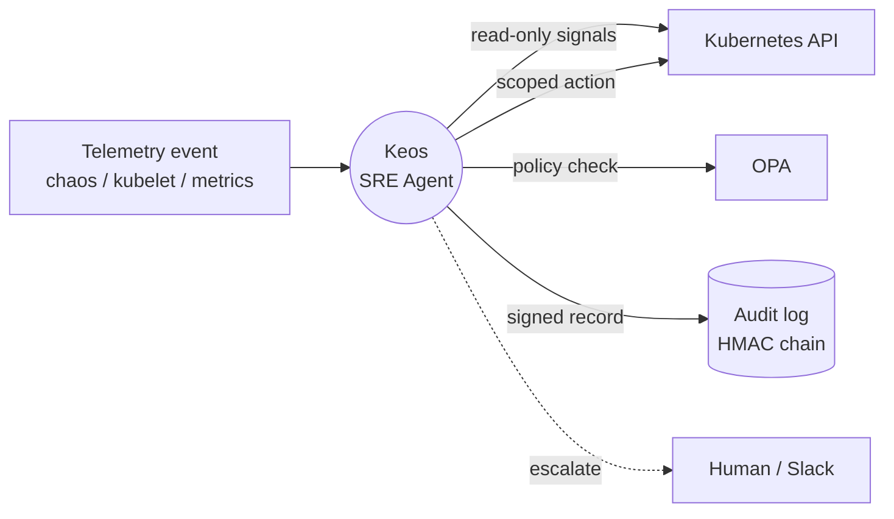
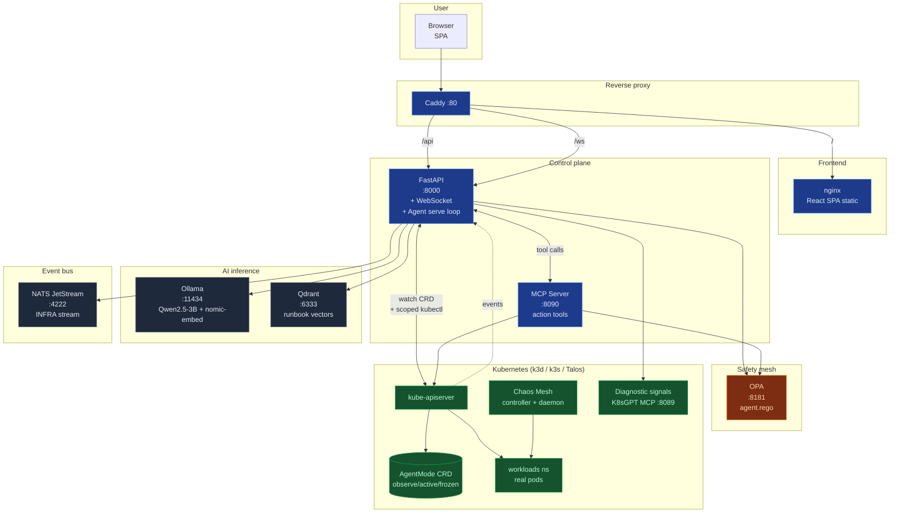
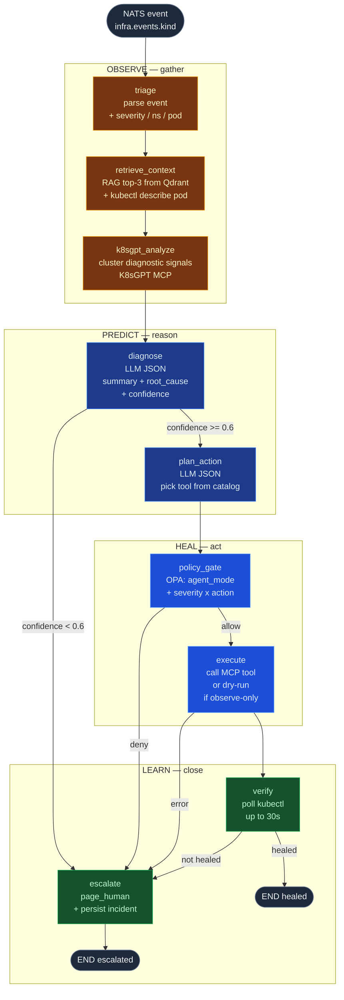
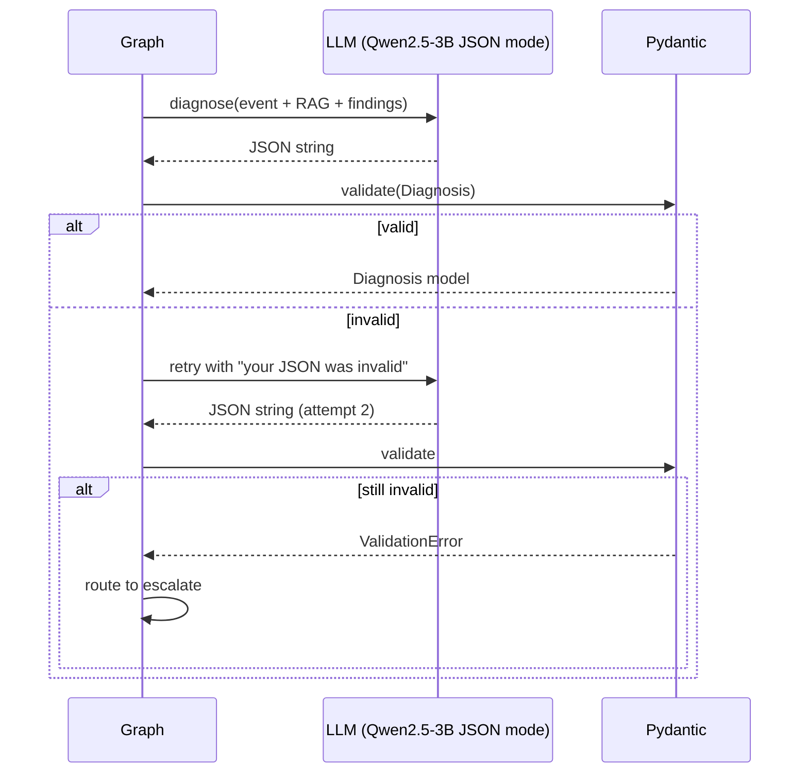
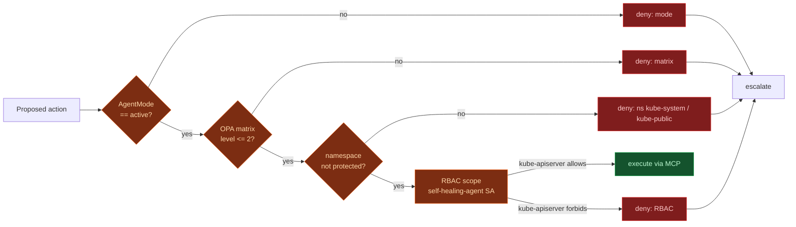
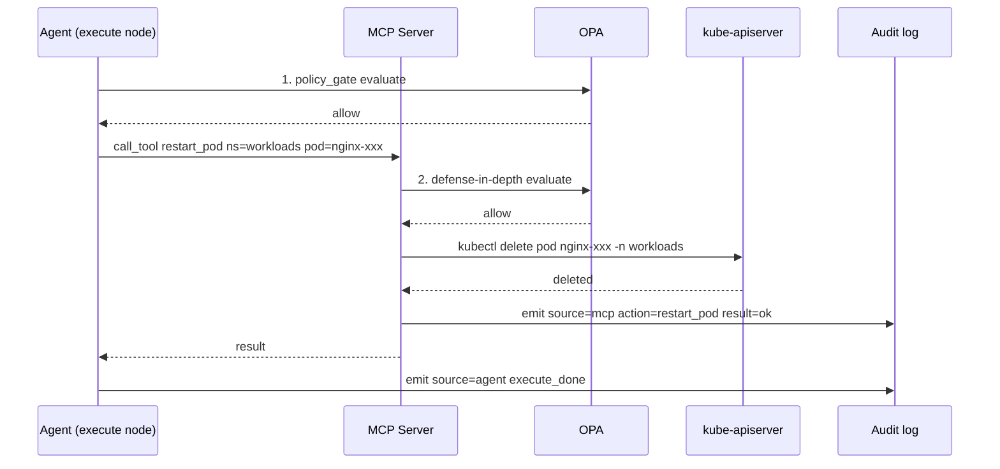
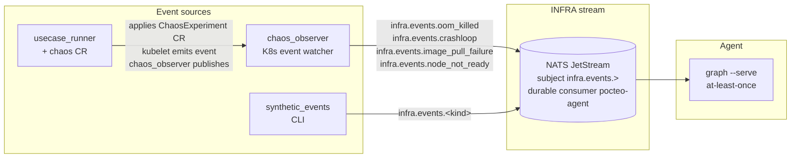
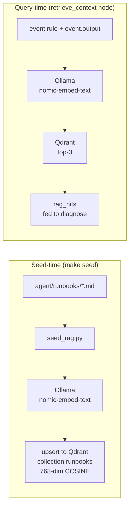
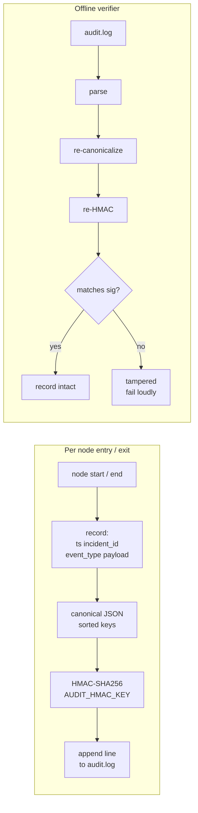
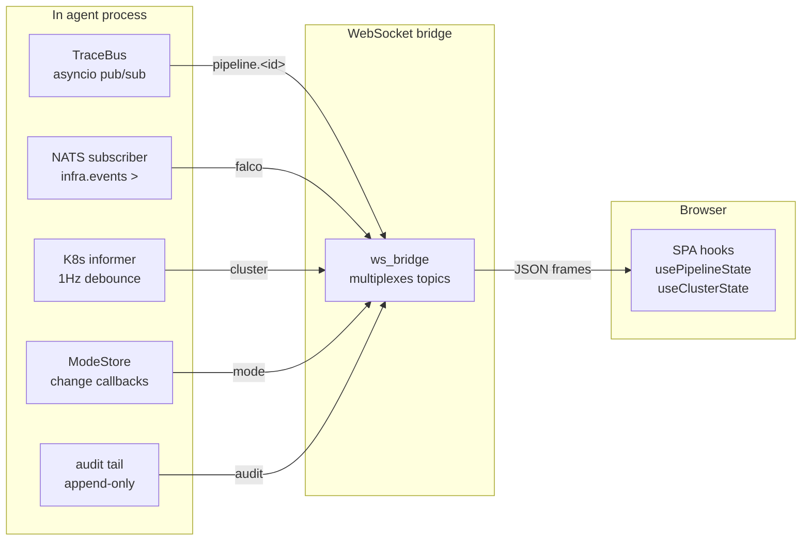

# Keos SRE Agent — Architecture

This document is the **bible**. Read it once, in order, and you will be able
to reason about every other file in the repo without surprise. Every other
doc (USER_GUIDE, INSTALL, TALOS, CONFIG_REFERENCE) refers back here.

It is built in layers:

1. **The 10-second pitch** — one diagram, one paragraph.
2. **The macro architecture** — every running container and how they talk.
3. **The agent loop** — the LangGraph state machine, node by node.
4. **The safety mesh** — OPA policy, AgentMode CRD, MCP boundary, HMAC audit.
5. **The data planes** — RAG store, telemetry bus, audit chain, WebSocket fan-out.
6. **The deployment shapes** — laptop, edge k3s, Talos, air-gapped.
7. **The request lifecycle** — one event traced from publish to healed.

> **Convention.** All diagrams are Mermaid. They render natively in
> GitHub, GitLab, VS Code (with the Mermaid extension), and most IDE
> previewers. If a diagram looks broken in your viewer, copy the fenced
> block into <https://mermaid.live> to inspect it.

---

## 1. The 10-second pitch



Keos receives an infrastructure event, decides whether to act, gates the
action through Open Policy Agent, executes under scoped RBAC, verifies
the cluster healed, and writes a tamper-evident audit record. If
confidence is low, the policy denies, the action fails, or the cluster
didn't heal — it escalates to a human instead.

The loop has a name: **Observe → Predict → Heal → Learn**.

---

## 2. Macro architecture

Everything that runs when you `make demo-ui` on a laptop. On a real
cluster the same components run as Pods; only the boundaries change
(see §6).



### Why each component exists

| Component | Why we need it | What it gives up |
|---|---|---|
| **Caddy** | Single URL (`http://localhost`), terminates TLS in prod, WebSocket-aware reverse proxy. | One more hop. We accept it because it makes the demo URL trivial. |
| **SPA (React + Vite)** | Multi-view UI without a heavy server framework. Bilingual EN/FR via i18next. | Bearer-token auth means a paste-from-`.env.local` step on first load. |
| **FastAPI + Agent serve loop** | One process holds: the LangGraph runtime, the NATS consumer, the WebSocket multiplexer, the ModeStore K8s watcher, the audit logger, the chaos observer. Single asyncio event loop = fewer race conditions, fewer ports. | If this process dies, all the above stop together. (Mitigation: K8s Deployment + liveness probe in prod.) |
| **MCP server** | The action catalog is reachable from any MCP client (Claude Desktop, kagent, Cursor) under the same OPA + RBAC + audit guarantees the agent itself uses. The agent's `execute` node calls *its own* MCP server — the abstraction is real. | One more network hop on the act path. Defense-in-depth justifies it. |
| **Ollama** | Local LLM inference. CPU-only is fine for Qwen2.5-3B (~1.9 GB quantized). No GPU dependency = runs on Jetson and laptop alike. | Slow first call (~60 s warmup). Mitigated by `keep_alive=30m`. |
| **Qdrant** | Vector store for the RAG corpus (7 SRE runbooks). 768-dim cosine, in-process FAISS-quality without the C++ build pain. | Another stateful service to back up. |
| **NATS JetStream** | Durable event bus. The agent is a JetStream consumer with at-least-once delivery — no events lost on restart. Subject is `infra.events.<kind>`. | Single point of failure (mitigated by JetStream's replication in cluster mode). |
| **OPA** | Externalised policy. The action × severity × mode matrix lives in `policies/agent.rego` — auditable, hot-reloadable, decoupled from agent code. | One more service. The HTTP call is sub-millisecond. |
| **AgentMode CRD** | Kill-switch. Cluster-scoped singleton (`default`). Flipping `spec.mode` to `frozen` or `observe-only` immediately disarms the agent without restarting anything. | Adds a CRD to install. Worth it. |
| **Chaos Mesh** | Real fault injection (PodChaos, StressChaos, NetworkChaos, IOChaos) instead of synthetic Falco-shaped events. The agent observes *real* kubelet reactions. | Cluster-level install; needs the right containerd socket path on Talos (see TALOS.md). |
| **K8sGPT (MCP)** | Independent diagnostic signal source. Rule-based, deterministic, reads the live API. The LLM consumes pre-digested findings instead of inventing them. | One more service. The agent gracefully degrades if it's unreachable. |

---

## 3. The agent loop (LangGraph)

This is the heart. Nine nodes, four phases, three escape hatches to
`escalate`. Each node is a pure async function that takes the
`IncidentState` TypedDict and returns a partial dict that LangGraph
merges into the state.



### Node-by-node

| Node | Phase | Reads | Writes | Can route to `escalate`? |
|---|---|---|---|---|
| `triage` | observe | NATS event payload | `severity`, `namespace`, `pod`, `rule_id` | no |
| `retrieve_context` | observe | rule + output text | `rag_hits` (top-3 chunks), `pod_describe` | no |
| `k8sgpt_analyze` | observe | namespace, pod | `k8sgpt_findings: list[Finding]` (empty on failure — soft degrade) | no |
| `diagnose` | predict | event + RAG + findings + describe | `diagnosis: {summary, root_cause, confidence, evidence, notes}` | **yes** if `confidence < 0.6` |
| `plan_action` | predict | diagnosis + tool catalog | `proposed_action: {tool, args, scope, reversible}` | no (constrained by catalog) |
| `policy_gate` | heal | `proposed_action`, `severity`, `mode` | `policy_decision: {allow, reasons[]}` | **yes** if `allow=false` |
| `execute` | heal | `proposed_action`, `mode` | `action_result: {ok, dry_run, output, error}` | **yes** if `ok=false` |
| `verify` | learn | `action_result.target` | `verification: {healed, observations}` | **yes** if `healed=false` |
| `escalate` | learn | full state | `escalated=true`, emits `page_human` | terminal |

### Why an LLM at all?

Two narrow places — both with tight schemas and a retry-or-escalate hook:



The LLM never *acts* — it produces a typed plan that the policy gate
either accepts or rejects. If the model hallucinates a tool name not in
the catalog, the Pydantic `ToolName = Literal[...]` validator catches it
and we escalate. Total cost of LLM failure: one human page, zero
cluster damage.

---

## 4. The safety mesh

Four orthogonal guards. Each can independently veto an action. All four
must agree for anything destructive to happen.



### Layer 1 — AgentMode CRD (the kill-switch)

Cluster-scoped CR, singleton `default`. `spec.mode ∈ {observe-only, active, frozen}`.

```yaml
apiVersion: security.poc/v1alpha1
kind: AgentMode
metadata:
  name: default
spec:
  mode: observe-only   # | active | frozen
```

`mode_store.py` runs a kubernetes-client watch on a daemon thread. Reads
from the graph are O(nanoseconds); mode flips propagate in <1 s. The
`execute` node reads `await mode_store.get()` at the moment of execution
— so a `kubectl patch agentmode default …` mid-incident takes effect on
the next graph step, not the next event.

### Layer 2 — OPA matrix (the rulebook)

Lives in `policies/agent.rego`. Action × severity matrix:

| Action | scope | low | medium | high | critical |
|---|---|---|---|---|---|
| `restart_pod` | pod | L1 | L1 | L2 | L2 |
| `rollout_undo` | deploy | L3 | L2 | L1 | L1 |
| `scale_deployment` | deploy | L2 | L1 | L1 | L1 |
| `cordon_node` | node | L3 | L2 | L1 | L1 |
| `drain_node` | node | L4 | L3 | L2 | L1 |
| `page_human` | n/a | L1 | L1 | L1 | L1 |

`L1`–`L2` → allow. `L3`–`L4` → deny. Hard-denies (regardless of matrix):

- target namespace ∈ `{kube-system, kube-public}`
- `agent_mode != "active"`
- unknown action or unknown severity

The matrix is **inline** in Rego — no `data.json` indirection. Edit one
file, `docker compose restart opa`, done.

### Layer 3 — Namespace boundary (RBAC)

The `self-healing-agent` ServiceAccount in `security` namespace is bound
to a Role in `workloads` only:

```yaml
# Role (workloads namespace)
- apiGroups: [""]
  resources: [pods]
  verbs: [get, list, watch, delete, patch]
- apiGroups: [apps]
  resources: [deployments, deployments/scale]
  verbs: [get, list, patch]
# ClusterRole (for node-level actions)
- apiGroups: [""]
  resources: [nodes]
  verbs: [patch, update]   # cordon/drain
```

Even if OPA mis-allows a `delete pod` in `kube-system`, the API server
denies it: the SA has no Role binding there.

### Layer 4 — MCP boundary (defense-in-depth)

The action path is **agent → MCP → OPA → kubectl**, not
**agent → OPA → kubectl**. Both the agent's `policy_gate` node *and* the
MCP server's pre-execute check call OPA. If the decisions disagree the
event is logged loudly + the action is denied.



Why two checks? **Threat model.** If an attacker compromises the agent
process but not the MCP server, they can't bypass policy. If they
compromise the MCP server but not OPA, they can't bypass policy. The
agent itself is *also* a client — proving the abstraction. Claude
Desktop or kagent calling the same tools are subject to the same gate.

---

## 5. The data planes

### 5.1 Telemetry bus (NATS JetStream)



The `chaos_observer` daemon watches `core/v1/Event` across `workloads`
and translates Kubernetes events (`OOMKilled`, `BackOff`,
`ImagePullBackOff`, `NodeNotReady`, …) into NATS messages. Debounced at
one publish per (pod, reason) per 60 s to avoid noise.

### 5.2 RAG store (Qdrant + Ollama embeddings)



Each runbook is one chunk (they're small — ~30 lines of Markdown). The
collection is `runbooks`, 768-dim, COSINE. `seed_one(slug, text)` allows
hot-adding a runbook at use-case-run time.

### 5.3 Audit chain (HMAC over canonical JSON)



HMAC over **canonical JSON** (sorted keys, no whitespace) so verification
is reproducible regardless of dict insertion order. The key is in
`AUDIT_HMAC_KEY`; rotate before any non-laptop use. Verifier:

```python
from agent.audit import verify_audit_log
n_records, broken = verify_audit_log("agent/audit.log", key)
assert broken == []
```

### 5.4 WebSocket fan-out (live UI updates)



Clients subscribe to topics over `/ws/events`. Each LangGraph node emits
`pipeline.<incident_id>` start/end events through the TraceBus
synchronously — what the UI animates is the same record that's in the
audit log, byte for byte.

---

## 6. Deployment shapes

Same Pods, same OPA, same audit. The only differences are *where the
containers run* and *who routes traffic*.

```mermaid
flowchart TB
    subgraph Laptop["Laptop demo (docker-compose + k3d)"]
        L_Caddy[caddy:80]
        L_API[api]
        L_MCP[mcp-server]
        L_FE[frontend]
        L_Stores[(ollama / qdrant / nats / opa)]
        L_K3D[k3d cluster<br/>+ chaos-mesh]
        L_Caddy --> L_FE
        L_Caddy --> L_API
        L_API --> L_Stores
        L_API --> L_MCP
        L_API -. host.docker.internal .-> L_K3D
    end

    subgraph Edge["Edge K8s (k3s / Talos / EKS, via Helm)"]
        E_Ing[Ingress / LoadBalancer]
        E_Caddy[caddy Deployment]
        E_API[api Deployment]
        E_MCP[mcp-server Deployment]
        E_FE[frontend Deployment]
        E_Stores[ollama / qdrant / nats / opa<br/>StatefulSets + PVCs]
        E_Agent[agent loop runs<br/>INSIDE the cluster<br/>via in-cluster SA]
        E_Chaos[chaos-mesh<br/>sub-chart]
        E_Ing --> E_Caddy
        E_Caddy --> E_FE
        E_Caddy --> E_API
        E_API --> E_Stores
        E_API --> E_MCP
        E_API --- E_Agent
        E_Agent --> E_Chaos
    end
```

| Aspect | Laptop | Edge K8s |
|---|---|---|
| Container runtime | Docker Desktop (Linux containers) | containerd / cri-o |
| Persistence | Docker named volumes | PVCs (any conformant StorageClass) |
| Cluster auth | Host kubeconfig → `host.docker.internal:6550` | In-cluster ServiceAccount |
| Reverse proxy | Caddy compose service :80 | Caddy Deployment + Ingress (cert-manager optional) |
| Bearer token | `.env.local` (gitignored) | Secret `pocteo-pocteo-auth` |
| Mode CR | Same CRD | Same CRD |
| Chaos Mesh | Helm install during `make cluster` | Helm sub-chart in the Keos chart |

Talos specifics (containerd socket at `/run/containerd/containerd.sock`,
air-gapped image cache via `talosctl image cache`) are documented in
[TALOS.md](TALOS.md). The Helm chart templates take a `runtime` value to
toggle between k3s / containerd / cri-o socket paths.

---

## 7. Request lifecycle — one event end to end

This is what actually happens when you click **Run** on a use case named
"Memory leak". Follow it once in this doc; you'll never need to ask "who
calls what" again.

```mermaid
sequenceDiagram
    autonumber
    participant U as User (SPA)
    participant API as FastAPI
    participant UR as usecase_runner
    participant K as kube-apiserver
    participant CM as Chaos Mesh
    participant Kub as kubelet
    participant CO as chaos_observer
    participant N as NATS
    participant G as LangGraph
    participant O as Ollama
    participant Q as Qdrant
    participant KG as K8sGPT
    participant OPA
    participant MCP
    participant A as Audit log
    participant WS as WebSocket clients

    U->>API: POST /api/usecases/lib-memory-leak/run
    API->>UR: run(use_case)
    UR->>K: apply ChaosExperiment (StressChaos, 30s TTL)
    K->>CM: ChaosExperiment CR
    CM->>Kub: inject memory stress into nginx-demo-xxx
    Kub-->>K: emit Event reason=OOMKilled pod=nginx-demo-xxx
    K-->>CO: watch event
    CO->>N: publish infra.events.oom_killed
    N->>G: deliver to durable consumer pocteo-agent

    G->>A: pipeline.triage.start
    G->>WS: trace event
    G->>G: triage -> severity=high, ns=workloads, pod=nginx-demo-xxx
    G->>A: pipeline.triage.end

    G->>O: embed("OOMKilled + output")
    O-->>G: vector
    G->>Q: search top-3 in runbooks
    Q-->>G: 001-memory-leak.md + 002-crashloop.md + ...
    G->>K: kubectl describe pod nginx-demo-xxx
    K-->>G: pod spec + events
    G->>A: pipeline.retrieve_context.end

    G->>KG: analyze(namespace=workloads)
    KG-->>G: findings: [Pod OOMKilled, container memory limit too low]
    G->>A: pipeline.k8sgpt_analyze.end

    G->>O: chat(diagnose, evidence)
    O-->>G: {confidence: 0.82, root_cause: "...", ...}
    G->>O: chat(plan_action, tool catalog)
    O-->>G: {tool: rollout_undo, args: {deployment: nginx-demo, ns: workloads}}
    G->>A: pipeline.diagnose.end + pipeline.plan_action.end

    G->>OPA: evaluate {action: rollout_undo, sev: high, mode: active, target: workloads}
    OPA-->>G: allow
    G->>A: pipeline.policy_gate.end allow

    G->>MCP: call_tool rollout_undo
    MCP->>OPA: evaluate (defense-in-depth)
    OPA-->>MCP: allow
    MCP->>K: kubectl rollout undo deploy/nginx-demo -n workloads
    K-->>MCP: rolled back
    MCP->>A: source=mcp action=rollout_undo result=ok
    MCP-->>G: result
    G->>A: pipeline.execute.end

    G->>K: poll pod readiness up to 30s
    K-->>G: 3/3 Ready
    G->>A: pipeline.verify.end healed=true
    G->>WS: incident.healed
    Note over G,WS: SPA timeline updates green; <br/>telemetry sidebar shows pods Ready
```

### Inputs and outputs by step (the cheat sheet)

| Step | Input | Output | Stored in |
|---|---|---|---|
| 1–3 | Use case definition | ChaosExperiment CR | k8s (TTL 30s) |
| 4–7 | StressChaos | OOMKilled event | k8s event stream |
| 8–9 | K8s event | `infra.events.oom_killed` | NATS JetStream |
| 10–12 | NATS event | `IncidentState` initialised | in-memory + audit |
| 13–17 | embed + vector search | RAG hits + describe | state |
| 18–19 | live cluster | K8sGPT findings | state |
| 20–22 | event + RAG + findings + describe | Diagnosis + ProposedAction | state + audit |
| 23–25 | proposed action | PolicyDecision | OPA → state + audit |
| 26–32 | proposed action | ActionResult | MCP → kubectl → audit |
| 33–36 | target | Verification (healed=true/false) | state + audit |
| WS | every node start/end | UI frames | TraceBus → /ws/events |

---

## What you now know

If you can answer these in your own words, you understand the system:

1. **Where does an event enter the system?** NATS JetStream subject
   `infra.events.<kind>`, produced by `chaos_observer` watching K8s
   events. The agent is a durable consumer.
2. **Who decides what to do?** `diagnose` (LLM, advisory) → `plan_action`
   (LLM, constrained by `ToolName` literal). The LLM picks; OPA decides
   if it's allowed.
3. **What stops the agent from doing damage?** Four orthogonal guards:
   AgentMode CRD, OPA matrix, namespace whitelist, RBAC scope. Plus the
   MCP server re-checks OPA before any side effect.
4. **Where is the audit?** `agent/audit.log` (laptop) or
   `/var/log/pocteo/audit.log` (cluster Pod). One JSON object per line,
   HMAC-SHA256 over canonical JSON. Verifier function in `agent/audit.py`.
5. **How do I disarm it instantly?** `kubectl patch agentmode default
   --patch-file manifests/patches/mode-observe.yaml`. The watch picks
   it up in <1 s.
6. **What's the same and what's different on Talos?** Same Pods, same
   OPA, same audit. Different: containerd socket path
   (`/run/containerd/containerd.sock`), image pre-pull via `talosctl
   image cache`, in-cluster ServiceAccount instead of host kubeconfig.

If something else in the codebase surprises you, that's a documentation
bug — open an issue and tell us where the diagram should have warned
you.
