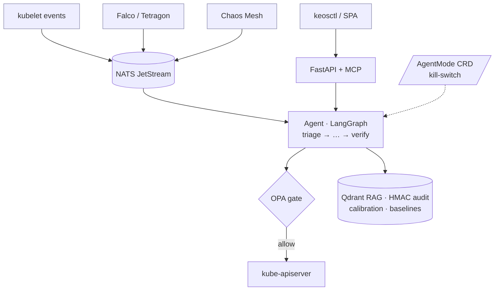
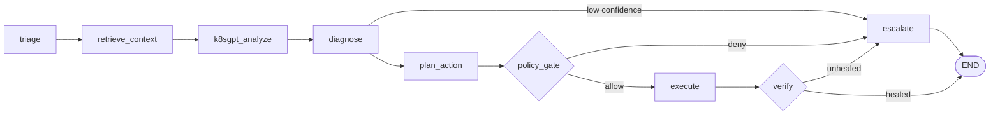
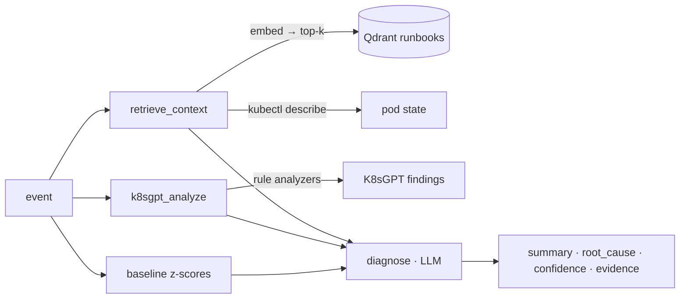

# Architecture

Keos is an **autonomous SRE + security agent that lives inside the edge
Kubernetes cluster it protects**. It observes the cluster, diagnoses incidents
with a local LLM + retrieval, proposes a remediation, runs that remediation
through a policy gate, executes it under scoped RBAC, verifies the outcome, and
writes a tamper-evident audit record — all without phoning home.

This page is the system map. For *operating* it see the
[User & Operator Guide](./USER_GUIDE.md); for *installing* it see
[Installation](./INSTALLATION.md); for *building & releasing* it see
[Operations](./OPERATIONS.md).

## 1. The big picture



The loop has a name: **Observe → Predict → Heal → Learn**. Everything runs
**in-cluster**. The only outbound traffic is optional (model/image pulls at
install); at steady state Keos is self-contained — essential for air-gapped
sites.

## 2. The self-healing loop (the agent graph)

The heart of Keos is an explicit **LangGraph state machine** — not a free-form
ReAct loop. Every incident flows through the same nine nodes, each a pure
`state → state` function that emits one audit record:



| Node | Responsibility |
|---|---|
| **triage** | Parse the event → severity, namespace, pod, rule, **domain** (`sre` / `security`). Skips stale SRE events (a pod that already recovered) — but never skips a security event for being "healthy". |
| **retrieve_context** | Embed the event, pull top runbooks from Qdrant, fetch `kubectl describe` for the target. |
| **k8sgpt_analyze** | Enrich with K8sGPT structured findings (analyzers, not summaries). Degrades gracefully if K8sGPT is down. |
| **diagnose** | LLM → `{summary, root_cause, confidence, evidence[]}`. Retries once on invalid JSON, then escalates. |
| **plan_action** | LLM constrained to the **tool catalog** → `{tool, args, scope, reversible}`. |
| **policy_gate** | Build the OPA input, evaluate the severity × action matrix at the current mode. Deny → escalate. |
| **execute** | In `active` mode, dispatch through the MCP server (defense-in-depth: MCP re-checks OPA). In `observe-only`, dry-run. |
| **verify** | Poll the cluster ~30 s; set `verification.healed`. Unhealed → escalate. |
| **escalate** | Page a human / the IR channel; mark the incident escalated. |

On CPU the full loop is minutes; on a GPU edge node (Jetson Orin) it is
**seconds** end to end.

### Context & enrichment (RAG + K8sGPT)

`diagnose` is only as good as what it's given. Three nodes feed it structured
context *before* the LLM sees the event:



- **retrieve_context (RAG)** — embeds the event with `nomic-embed`, pulls the
  top-k runbook chunks from Qdrant **filtered to the incident's domain** (so a
  security incident retrieves security runbooks, not SRE ones), and attaches the
  target's `kubectl describe`.
- **k8sgpt_analyze (enrichment)** — runs **K8sGPT's rule-based analyzers** (not
  LLM summaries) over the live cluster and returns **structured findings**
  (`{kind, name, error, parent_object, details}`), filtered to the incident's
  pod or its owner. It is **best-effort**: if K8sGPT is unreachable the node
  logs and returns `[]`, and the graph continues — diagnosis degrades, it never
  blocks. K8sGPT is consumed over HTTP/MCP, so it's swappable.
- **baselines** — the σ-above-baseline z-score for the pod's metrics (see §7).

`diagnose` then reconciles all three (event + runbooks + K8sGPT findings +
baseline) into `{summary, root_cause, confidence, evidence[]}`. This is why
Keos diagnoses *real cluster noise* better than the small local LLM could alone
— the model arbitrates between independent structured signals rather than
hallucinating from a single event string.

### Action catalog

| Domain | Tools |
|---|---|
| **SRE** | `restart_pod`, `rollout_undo`, `scale_deployment`, `cordon_node`/`uncordon_node`, `drain_node`, `evict_workload`, `tune_hpa`, `set_resources`, `revert_drift`, `page_human` |
| **Security** | `isolate_pod`, `apply_network_policy`, `quarantine_pod`, `kill_pod`, `capture_forensics`, `page_security` |

Containment tools are **reversible** (delete the NetworkPolicy + strip the
label) except `kill_pod`. Reversal is one command: `keosctl quarantine release`.

## 3. The safety mesh

Autonomy is only safe because four independent controls gate every action:

1. **AgentMode CRD** (cluster-scoped kill-switch) — `observe-only` (dry-run,
   default), `active` (acts after the gate), `frozen` (no-op). Read at the
   *moment of execution*, so flipping it mid-incident takes effect immediately.
2. **OPA policy gate** — a Rego **severity × action matrix**. Each tool has a
   required autonomy level per severity; containment is denied on weak signals,
   allowed at high/critical. Hard-deny rules protect `kube-system`/`kube-public`
   and block any action outside `active` mode. The matrix runs in *both* the
   agent and the MCP server — they must agree, or it escalates.
3. **Scoped RBAC** — the ServiceAccount can do only what the catalog needs
   (patch pods, manage NetworkPolicies, read across namespaces) and nothing in
   protected namespaces.
4. **HMAC-signed audit chain** — every transition is one JSON line signed with
   HMAC-SHA256 over canonical JSON. `keosctl audit verify` walks the chain and
   flags any tampered record. This is the forensic guarantee.

Per-rule **confidence calibration** (learned from graded outcomes) decides when
a diagnosis is trustworthy enough to act vs. escalate.

### Policy gate (the OPA matrix)

The gate is a Rego policy (`policies/agent.rego`) evaluating
`{action, severity, agent_mode, target.namespace}`. It is **default-deny**: an
action runs only if **no** deny-reason fires. Four hard-deny gates, then the
matrix:

1. unknown action (not in the catalog),
2. unknown severity,
3. **protected namespace** (`kube-system` / `kube-public`),
4. **mode ≠ `active`** (observe-only/frozen never execute).

Then a `levels[action][severity]` lookup returns an **autonomy level L1–L4**:
**L1/L2 = allowed**, **L3/L4 = denied → escalate**. Lower-risk/higher-confidence
combinations get lower levels (auto-act); risky or weak-signal ones get L3+
(page a human). Examples:

```
restart_pod   : low L1 · medium L1 · high L2 · critical L2     (allowed across the board)
drain_node    : low L4 · medium L3 · high L2 · critical L1     (gated low, autonomous when severe)
isolate_pod   : low L3 · medium L3 · high L2 · critical L1     (escalate-first containment)
page_human    : L1 everywhere                                   (always allowed)
```

The same matrix is evaluated **twice** — in the agent's `policy_gate` node and
again in the MCP server before any side effect (defense-in-depth). Read it with
`keosctl policy show`, test any decision with `keosctl policy test <action>
<severity> <ns> <mode>`, and edit it in `policies/agent.rego` (see the
[Developer Guide](./DEVELOPER_GUIDE.md#extending-the-agent)).

## 4. Components

| Pod | Role |
|---|---|
| **api** | FastAPI — REST + WebSocket, the agent runtime (`--serve`), the Falco webhook, the pipeline trace bus. |
| **mcp-server** | Model-Context-Protocol server exposing the action catalog; the OPA-gated execution boundary (also drivable from Claude Desktop). |
| **frontend** | React SPA (Cluster, Incidents, Pipeline, Use Cases, Control, Settings), served by nginx. |
| **caddy** | Single-URL reverse proxy (`/` → SPA, `/api` + `/ws` → api). |
| **ollama** | Local LLM inference (qwen2.5 chat + nomic-embed). GPU-offloaded when available. |
| **qdrant** | Vector store for the runbook corpus (RAG). |
| **nats** | JetStream durable event bus. |
| **opa** | Policy engine (the Rego matrix). |
| *falco / tetragon* | Optional eBPF runtime-security sensors. |
| *chaos-mesh* | Optional fault injection driving the Use-Case demos. |

First-party images: `keos-api`, `keos-mcp-server`, `keos-frontend` (multi-arch
amd64 + arm64).

## 5. Data planes

- **Event plane** — kubelet events (debounced observer), Falco/Tetragon
  detections (falcosidekick → the api webhook), and synthetic Use-Case events
  land on NATS `infra.events.*` / `security.events.*`; the agent is a durable
  JetStream consumer.
- **Knowledge plane** — runbooks embedded into Qdrant; `diagnose` retrieves the
  top matches per domain.
- **State plane** — the HMAC audit log, the per-rule calibration DB, the ML
  baselines DB, finished incidents, and pipeline traces (PVC-backed; captured by
  `keosctl backup`).

## 6. The security domain

Beyond SRE self-healing, Keos runs a parallel **runtime-security** pipeline
(same graph, `domain=security`): Falco/Tetragon detect (reverse shell, miner,
priv-esc, exfil) → falcosidekick forwards the alert with a bearer token to the
api webhook → it becomes a `security.events.*` incident → diagnose → OPA-gated
**containment** (`isolate_pod` writes a deny-all NetworkPolicy + quarantine
label) → signed audit. Sensors are capability-gated by kernel: `modern_ebpf`
(BTF kernels), `ebpf-prebuilt` (BTF-less, e.g. Jetson L4T — a probe built once
per kernel via `keosctl falco-probe build`), or `off` (synthetic-event demo).

## 7. Continuous intelligence

Four loops make the agent better over time and let it act *before* a symptom:

- **Confidence calibration** — each rule keeps a learned threshold from graded
  outcomes (p50/p90 telemetry). `diagnose` confidence is compared against the
  per-rule threshold (falling back to the global `agent.confidenceThreshold`
  until enough samples exist) to decide act-vs-escalate. Inspect/override with
  `keosctl calibration {list,set,reset}`.
- **ML baselines (anomaly framing)** — a rolling, **seasonal** baseline per
  `(metric, namespace, pod)`: the *seasonal residual* is `current −
  hour-of-day median` over 24 hourly buckets (≥ 7 days of 15-min samples), fed
  through a **σ-floored z-score**. `diagnose` gets "this pod's memory is N σ
  above its time-of-day baseline" instead of a raw number.
- **Predictive forecasting** — a pure-Python **linear-regression (OLS)** fit
  over the baseline samples projects each metric to **5 / 15 / 60-minute**
  horizons (with an **r² floor** so a noisy fit never acts). When a forecast
  crosses a threshold, the agent fires a *predictive* incident **ahead of** the
  reactive symptom and can choose `tune_hpa`, `set_resources`, or
  `evict_workload` proactively (all OPA-gated like any action).
- **GitOps drift detection** — watches a source-of-truth (a manifest set; a
  pluggable `SourceOfTruth` provider can read Git/Flux/Argo) and publishes a
  `infra.events.drift` incident in real time, which the agent triages and can
  `revert_drift`. This is the *reactive* complement to the *scheduled* GitOps
  **delivery** in §8 — Flux owns desired state; the agent reacts between
  reconciles.

## 8. Deployment & delivery

Keos installs as a single Helm chart (`pocteo`) onto any conformant cluster —
k3s, Talos, Kairos, kubeadm, k3d, EKS/GKE/AKS — on amd64 or arm64, with optional
GPU. For the **private-registry, air-gapped** posture, images + the OCI chart
live only in a local `:5000` registry, and updates flow by **pull-based GitOps**:
Flux on the cluster reconciles the desired state (chart + SOPS-encrypted values)
from the registry — no inbound access. See [Operations](./OPERATIONS.md) for the
release + GitOps flow and [Installation](./INSTALLATION.md) for every target.

## 9. Design principles

- **Closed-form graph, not an open agent** — every path is enumerable and auditable.
- **Policy as data** — the risk matrix is Rego, not buried in prompts.
- **Reversible by default** — containment can always be undone; the kill-switch is one CRD field.
- **Edge-first** — CPU-capable, GPU-accelerated, ARM64-native, air-gap-ready, no cloud dependency.
- **Everything signed** — the audit chain is the source of truth for "what did the agent do, and why".
