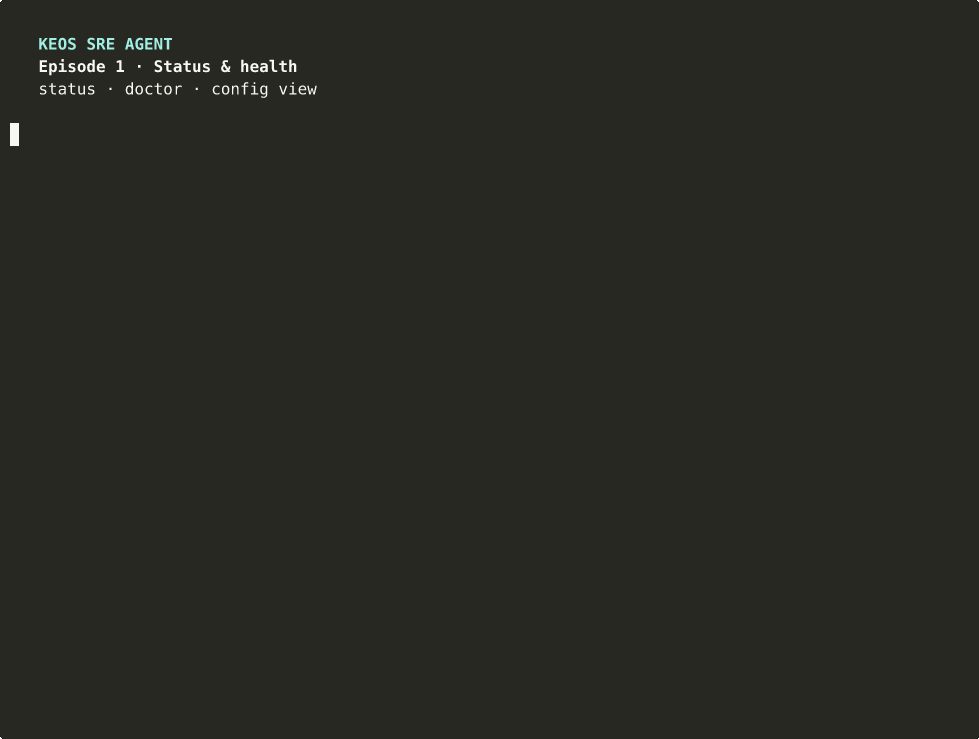
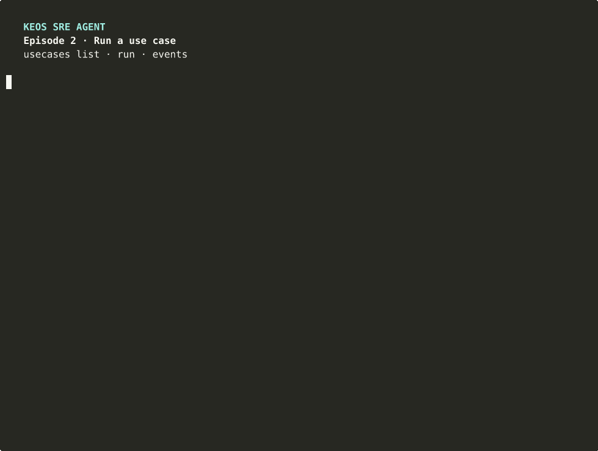

# User & Operator Guide

**Pocteo Platform** is the company; **Keos** is its Kubernetes edge OS; the
**Keos SRE Agent** (this product) is the autonomous reliability + security layer
that runs inside every edge node. This guide takes you from "what is it" to
"running it day to day." For the internals see [Architecture](./ARCHITECTURE.md);
to install see [Installation](./INSTALLATION.md); for every command see the
[CLI Reference](./CLI_REFERENCE.md).

## 1. What it is (and isn't)

Keos takes operational incidents from **telemetry → diagnosis → remediation →
verify** without an on-call human for the majority of known failure modes —
memory leaks, crashloops, ImagePullBackOff, node pressure, bad rollouts, config
drift, traffic surges (SRE), and reverse shells, miners, priv-esc, exfil
(security). It runs the loop **Observe → Predict → Heal → Learn** in-cluster, on
the edge, with no cloud dependency.

It is **not** a chat-for-kubectl, not a dashboard, and not a replacement for
your whole SRE org — it automates the known-knowns under a hard policy gate and
escalates everything else.

## 2. The agent loop

Each incident runs the nine-node graph (full detail in
[Architecture §2](./ARCHITECTURE.md#2-the-self-healing-loop-the-agent-graph)):
triage → retrieve context (RAG) → K8sGPT enrich → **diagnose** → plan action →
**OPA gate** → execute → verify → (escalate if low-confidence / denied /
unhealed). Watch it live in the SPA's **Pipeline** view or with
`keosctl events -w`.

## 3. The kill-switch & safety model

The agent's autonomy is controlled by the **AgentMode** CRD — the single most
important operator control:

```bash
keosctl mode                 # show current mode
keosctl mode observe-only    # dry-run: diagnose + propose, never mutate (default)
keosctl mode active          # act after the OPA gate allows
keosctl mode frozen          # no-op (maintenance windows)
```

Mode is read at the moment of execution, so flipping it takes effect on the next
(or current) action. Behind it sit three more controls — the **OPA matrix**
(severity × action), **scoped RBAC**, and the **HMAC audit chain**. Together
they guarantee the agent can only do allowed, reversible things, and that every
action is recorded and signed. See [Architecture §3](./ARCHITECTURE.md#3-the-safety-mesh).

## 4. Action catalog

SRE: `restart_pod`, `rollout_undo`, `scale_deployment`, `cordon_node`/
`uncordon_node`, `drain_node`, `evict_workload`, `tune_hpa`, `set_resources`,
`revert_drift`, `page_human`. Security: `isolate_pod`, `apply_network_policy`,
`quarantine_pod`, `kill_pod`, `capture_forensics`, `page_security`. Inspect or
test the gate:

```bash
keosctl policy show
keosctl policy test isolate_pod high workloads active     # → ALLOW
keosctl policy test isolate_pod high kube-system active    # → DENY (protected ns)
```

## 5. The web UI — walkthrough

`keosctl ui` port-forwards and opens the SPA (paste the token from
`keosctl token`). The app is bilingual (EN/FR, switch in the top bar) and has
six views:

### Cluster
Live nodes, namespaces, and pods with status, and a namespace picker. Updates
within ~1 s of a change. The fast way to see what the agent sees.

### Incidents
Every incident as a sortable, filterable table (severity · namespace · pod ·
diagnosis · action · outcome · mode-at-time). URL params reflect filters so a
view is shareable. Click any row for the **8-tab drill-down**: the **Falco/event**
that triggered it, the **RAG** runbooks retrieved, the **K8sGPT** findings, the
raw **LLM** diagnose/plan responses, the **policy** decision (allow/deny +
reasons), the **action** result, the **audit chain** (with per-record HMAC
✓/✗), and a **Pipeline replay** of that incident.

### Pipeline
The agent graph rendered as a live, animating flow — nodes light up as the
incident moves triage → … → verify, edges animate, and the active node's
input/output is one click away. Open it on `/pipeline/live` to watch a running
incident, or open a past incident to **replay** it with a scrubber
(play/pause/step, 0.5×–4×). This is the "wow" view for understanding *why* the
agent did what it did.

### Use Cases
The scenario library (SRE + security) with search/filter, plus the **New Use
Case** wizard — author a target, an event template, expected outcomes, and an
EN/FR runbook, then Run it.

### Control
Flip the **agent mode** (observe-only / active / frozen), action the
**pending-approval** queue (approve an L3-denied action with a human-override
audit marker, or deny with a reason), and browse the **audit log** with live
HMAC verification.

### Settings
Per-rule **calibration**, data **retention** windows, and language (EN/FR).

## Screencasts

Short terminal recordings of `keosctl` against a real cluster (also available as
asciinema `.cast` files in [`docs/assets/casts/`](./assets/casts)):

**Status + doctor + config**



**Run a use case end-to-end**



**Day-2 operations**


(Install · introspection · help: `ep00-install`, `ep03-introspection`,
`ep05-help` in the same folder.)

## 6. Use cases (drive the agent)

The use-case library fires realistic incidents so you can watch the agent act:

```bash
keosctl usecases list                 # sre + security scenarios
keosctl mode active
keosctl run lib-reverse-shell         # security: → isolate_pod + quarantine
keosctl run lib-crypto-miner          # security
keosctl events --domain security      # see the outcomes
```

Create your own in the SPA's **Use Cases → New** wizard (target, Falco/event
template, expected outcome, EN/FR runbook). Use cases that target real demo
workloads (`nginx-demo`, seeded at install) produce real containment you can
inspect and reverse (`keosctl quarantine release`).

## 7. Day-2 operations

```bash
keosctl status                 # pods + mode + release
keosctl doctor [--e2e]         # full health check (+ live security path)
keosctl top                    # one-screen live dashboard
keosctl logs api -f            # tail a component
keosctl models pull            # (re)pull the agent's models (default qwen2.5:3b)
keosctl backup -o keos.tar.gz  # snapshot state
keosctl upgrade                # helm upgrade --reuse-values
```

Release, private-registry, GitOps, GPU verification, observability, and DR live
in [Operations](./OPERATIONS.md).

## 8. Security operations

Keos runs a parallel runtime-security domain (Falco/Tetragon → detect →
contain). The full picture — sensor tiers, the detection→containment flow, the
containment catalog, and the security policy gate — is in
**[Security Domain](./SECURITY.md)**. When the eBPF sensors are installed, real
detections become incidents. Confirm the path end to end, then operate it:

```bash
keosctl doctor --e2e           # triggers a shadow-read; asserts an incident appears
keosctl quarantine list        # contained pods + their deny-all NetworkPolicies
keosctl quarantine release <pod> <ns>      # undo containment
```

Sensor tiers (BTF / prebuilt-probe / off) are chosen at install — see
[Installation → Security sensors](./INSTALLATION.md#security-sensors-falco--tetragon).

## 9. The audit trail

Every agent action is one HMAC-signed line. This is your forensic record:

```bash
keosctl audit tail -n 40
keosctl audit verify           # walks the chain; exits non-zero on any tamper
```

If verification fails, treat it as a security event — see the
[audit-tampering runbook](./runbooks/audit-tampering.md).

## 10. Configuration reference

Everything is a Helm value (`deploy/helm/pocteo/values.yaml`), readable/patchable
live:

```bash
keosctl values get                         # full effective values
keosctl values get agent.defaultMode
keosctl values set agent.confidenceThreshold=0.7
```

Key knobs: `agent.defaultMode`, `agent.confidenceThreshold`, `ollama.gpu.enabled`,
`falco.enabled`/`tetragon.enabled`, `networkPolicy.enabled`, `monitoring.enabled`,
`retention.{auditDays,incidentDays,traceDays}`, `global.imageRegistry`,
`auth.existingSecret` (GitOps/SOPS). Auth tokens come from the auth secret (or a
SOPS-managed one under GitOps).

## 11. Troubleshooting

`keosctl doctor` first — it names the fix for each failing check. For specific
failures (api/ollama/nats down, qdrant corruption, runaway graph, drift storm,
the agent took a destructive action, secret rotation, full DR) see the
[Runbooks](./runbooks/README.md).

## FAQ

- **Will it touch `kube-system`?** No — protected namespaces are hard-denied.
- **Can I stop it instantly?** `keosctl mode frozen`.
- **Does it phone home?** No. Inference + retrieval are in-cluster.
- **Can I undo a containment?** Yes — `keosctl quarantine release` (all
  containment except `kill_pod` is reversible).
- **GPU required?** No — CPU works; GPU just makes the loop seconds instead of
  minutes.
