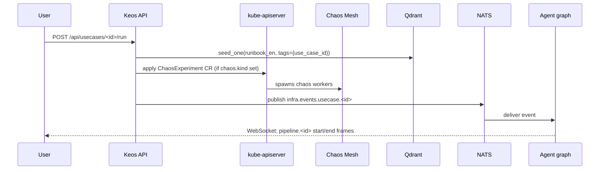

# Use Cases — five scenarios with Chaos Mesh

This is the hands-on tutorial. Five scenarios, each runnable end-to-end
in the **Use Cases** view of the SPA. Every scenario covers a different
SRE incident shape and exercises a different remediation tool in the
action catalog.

If you're new to Keos, do them in order — they build from "watch the
cluster react" (scenario 1) to "watch the agent reason about a
multi-symptom incident" (scenario 5).

> **Prerequisite.** A running Keos stack: `make demo-ui` works,
> `kubectl get ns chaos-mesh` shows the controller Running, mode is set
> to **active** (Control view), and you've pasted your bearer token on
> the SPA. If any of that's off, see [USER_GUIDE.md §6 Day-2 ops](USER_GUIDE.md).

---

## Contents

1. **The wizard at a glance** — six steps, what each one writes
2. **Scenario 1 — Memory leak** (`StressChaos` → `rollout_undo`)
3. **Scenario 2 — Crashing pod** (`PodChaos` → `restart_pod`)
4. **Scenario 3 — Bad image deploy** (synthetic-only → `rollout_undo`)
5. **Scenario 4 — Network degradation** (`NetworkChaos` → `scale_deployment`)
6. **Scenario 5 — Multi-symptom node pressure** (`StressChaos` + escalation)
7. **Scenario 6 — Approval-required action** (synthetic, low-severity drain → policy deny → pending approval)
8. **Inspecting the run** — what to look at, in what order
9. **Troubleshooting the wizard**
10. **Outbound notifications (Slack / generic webhook)**

---

## 1. The wizard at a glance

Open **Use Cases → New Use Case**. The wizard has six steps:

| # | Step | Required fields | Writes |
|---|---|---|---|
| 1 | **Context** | Name | `id`, `name`, `description_en`, `description_fr`, `tags[]` |
| 2 | **Target** | Namespace | `target.namespace`, `target.owner_kind`, `target.pod_name` **or** `target.pod_label_selector{}` |
| 3 | **Telemetry / Chaos** | Rule, Output template | `falco.rule`, `falco.priority`, `falco.output_template`, `falco.output_fields{}` (incl. `chaos.kind`, `chaos.action`, `chaos.duration`, …) |
| 4 | **Expected** | (none — but recommended) | `expectations.diagnosis_keywords[]`, `expectations.tool`, `expectations.policy_decision`, `expectations.outcome` |
| 5 | **Runbook** | (optional) | `runbook_en`, `runbook_fr` — embedded into Qdrant on **Run**, tagged with `use_case_id` |
| 6 | **Review** | — | (read-only) Save & Run, or Save only |

**Chaos Mesh integration lives in Step 3.** Pick a kind from the
dropdown (PodChaos, StressChaos, NetworkChaos, IOChaos) and the use-case
runner will apply a real `ChaosExperiment` CR with `TTLSecondsAfterFinished=30`
*before* publishing the synthetic event. Leave it on "None" for a
synthetic-only use case (NATS publish only, no cluster mutation).

### What happens when you click **Run**



The UI navigates to `/pipeline/<incident_id>` and the live timeline
populates as each node fires.

---

## 2. Scenario 1 — Memory leak in nginx-demo

**What we're simulating.** A container starts consuming more memory
than its `limits.memory` allows. The kubelet sees it cross the
threshold and emits an `OOMKilled` event. Keos should diagnose this as
a leak and roll the deployment back to the previous revision.

**Tool exercised.** `rollout_undo`.

### Wizard inputs

| Step | Field | Value |
|---|---|---|
| 1 | Name | `Memory leak in nginx-demo` |
| 1 | Description (EN) | `Container exceeds its memory limit and gets OOMKilled. Expect a rollout undo to the previous revision.` |
| 1 | Tags | `memory`, `oom`, `rollout` |
| 2 | Namespace | `workloads` |
| 2 | Owner kind | `Deployment` |
| 2 | Pod mode | **By label** |
| 2 | Labels | `app: nginx-demo` |
| 3 | **Chaos kind** | `StressChaos (CPU / memory stress)` |
| 3 | **Chaos action** | `memory` |
| 3 | **Chaos duration** | `45s` |
| 3 | Rule | `Container memory pressure` |
| 3 | Priority | `Critical` |
| 3 | Output template | `Container {pod} in {ns} exceeded memory limit` |
| 3 | Output fields | `kubelet.reason = OOMKilled` |
| 4 | Diagnosis keywords | `memory`, `OOMKilled`, `leak` |
| 4 | Expected tool | `rollout_undo` |
| 4 | Expected policy decision | `allow` |
| 4 | Expected outcome | `healed` |
| 5 | Runbook (EN) | _see snippet below_ |

**Runbook snippet (Step 5):**

```markdown
# Memory leak

## Symptom
A pod is repeatedly OOMKilled. `kubectl describe pod` shows
`Last State: Terminated  Reason: OOMKilled`. The deployment may be
rolling forward to keep replicas Ready but each new pod also dies.

## Diagnosis
If the OOMKill follows a recent deployment, the leak is likely in the
new image — not in workload growth. Roll back.

## Remediation
`rollout_undo` on the offending Deployment. Verify the previous
revision's pods stay Ready for >2 minutes.
```

### What you should see

1. **Timeline (Pipeline view).** `observe → predict → heal → learn`
   light up in order. The Heal phase's `execute` card shows
   `tool=rollout_undo` with the deployment name.
2. **Telemetry sidebar.** Pods Ready dips during the chaos window
   (the stressed pod gets evicted), then recovers as the rollback
   takes effect. Restarts counter increments.
3. **Audit tab (Incident detail).** Records with `source: mcp` and
   `human_override: false` — clean autonomous fix.
4. **Cluster view.** The Deployment's revision number drops by 1.

---

## 3. Scenario 2 — Crashing pod

**What we're simulating.** A pod gets killed externally and
Kubernetes restarts it. After a few rapid kills the container
transitions to `CrashLoopBackOff`. Keos should detect the loop and
issue a clean `restart_pod` (deleting the pod so the controller
re-schedules a fresh one).

**Tool exercised.** `restart_pod`.

### Wizard inputs

| Step | Field | Value |
|---|---|---|
| 1 | Name | `Crashloop on nginx-demo` |
| 1 | Tags | `crashloop`, `restart` |
| 2 | Namespace | `workloads` |
| 2 | Owner kind | `Deployment` |
| 2 | Pod mode | **By label** |
| 2 | Labels | `app: nginx-demo` |
| 3 | **Chaos kind** | `PodChaos (pod-kill / pod-failure)` |
| 3 | **Chaos action** | `pod-kill` |
| 3 | **Chaos duration** | `40s` |
| 3 | Rule | `Container restart loop` |
| 3 | Priority | `Error` |
| 3 | Output template | `Pod {pod} in {ns} has restarted repeatedly` |
| 3 | Output fields | `kubelet.reason = BackOff`, `restart_count = 5` |
| 4 | Diagnosis keywords | `crashloop`, `BackOff`, `restart` |
| 4 | Expected tool | `restart_pod` |
| 4 | Expected outcome | `healed` |

### What you should see

The chaos worker rapid-kills the target pod. Within ~20 s,
`chaos_observer` translates the kubelet's `BackOff` events into
`infra.events.crashloop` — the agent's input. Triage classifies it as
**high severity**; the policy gate allows `restart_pod` at L2.

After the chaos TTL elapses, the new pod stays Ready and `verify`
returns `healed=true`.

---

## 4. Scenario 3 — Bad image deploy (synthetic-only)

**What we're simulating.** An operator pushed a Deployment with a
typo in the image tag (`v1.2..0` instead of `v1.2.0`). Pods fail to
pull, sitting in `ImagePullBackOff` forever.

**Why no chaos here.** Image-pull failures come from the *Deployment
spec*, not from runtime perturbation. Chaos Mesh has no way to inject
this — you'd need to mutate the resource, which is exactly what the
agent will undo. We use a synthetic event (NATS publish only) and let
the agent reason about a real cluster state we set up manually.

**Tool exercised.** `rollout_undo`.

### Pre-step (one-time, outside the wizard)

Create a broken Deployment in `workloads`:

```powershell
kubectl --kubeconfig .\.kube\config apply -f - <<EOF
apiVersion: apps/v1
kind: Deployment
metadata:
  name: bad-image-demo
  namespace: workloads
  labels: { app: bad-image-demo }
spec:
  replicas: 1
  selector: { matchLabels: { app: bad-image-demo } }
  template:
    metadata: { labels: { app: bad-image-demo } }
    spec:
      containers:
      - name: app
        image: ghcr.io/keos/does-not-exist:v999
EOF
```

Wait ~15 s for the pod to enter `ImagePullBackOff`. Verify:

```powershell
kubectl --kubeconfig .\.kube\config get pods -n workloads -l app=bad-image-demo
# Should show STATUS = ImagePullBackOff or ErrImagePull.
```

You'll also need a previous good revision for `rollout_undo` to target —
patch the image once to create a second revision:

```powershell
kubectl --kubeconfig .\.kube\config -n workloads set image deployment/bad-image-demo app=ghcr.io/keos/does-not-exist:v998
```

### Wizard inputs

| Step | Field | Value |
|---|---|---|
| 1 | Name | `Bad image tag on bad-image-demo` |
| 2 | Namespace | `workloads` |
| 2 | Owner kind | `Deployment` |
| 2 | Pod mode | **By label** |
| 2 | Labels | `app: bad-image-demo` |
| 3 | **Chaos kind** | `None (synthetic event only)` |
| 3 | Rule | `Image pull failure` |
| 3 | Priority | `Error` |
| 3 | Output template | `Pod {pod} in {ns} failed to pull image` |
| 3 | Output fields | `kubelet.reason = ImagePullBackOff`, `container.image.repository = ghcr.io/keos/does-not-exist` |
| 4 | Diagnosis keywords | `image`, `pull`, `tag`, `registry` |
| 4 | Expected tool | `rollout_undo` |
| 4 | Expected outcome | `healed` |

### What you should see

`k8sgpt_analyze` is the star of this scenario — its findings include
the exact `Failed to pull image` line from the kubelet. The LLM's
`diagnose` step uses that as evidence. The `plan_action` LLM call
chooses `rollout_undo` because the runbook tells it that's the
remediation for image-pull failures with a recent revision.

> **Sanity check.** If you skipped the pre-step (no previous
> revision), `rollout_undo` itself succeeds but the new pods still fail
> to pull (you rolled back to a broken image too). `verify` returns
> `healed=false` and the graph routes to `escalate`. That's working as
> designed — the agent did its job; the human has more work to do.

---

## 5. Scenario 4 — Network degradation triggers traffic surge

**What we're simulating.** Network latency injected into the service
mesh causes upstream services to retry, doubling request volume on the
target Deployment. Liveness probes start failing intermittently. Keos
should detect the load and scale the Deployment up.

**Tool exercised.** `scale_deployment`.

### Wizard inputs

| Step | Field | Value |
|---|---|---|
| 1 | Name | `Traffic surge from network latency` |
| 1 | Tags | `network`, `latency`, `scale` |
| 2 | Namespace | `workloads` |
| 2 | Owner kind | `Deployment` |
| 2 | Pod mode | **By label** |
| 2 | Labels | `app: nginx-demo` |
| 3 | **Chaos kind** | `NetworkChaos (delay / loss)` |
| 3 | **Chaos action** | `delay` |
| 3 | **Chaos duration** | `60s` |
| 3 | Rule | `Sustained probe failures with elevated traffic` |
| 3 | Priority | `Warning` |
| 3 | Output template | `Pod {pod} in {ns} failing readiness under load` |
| 3 | Output fields | `kubelet.reason = Unhealthy`, `traffic.qps = 850`, `replicas.current = 3`, `chaos.latency = 300ms` |
| 4 | Diagnosis keywords | `latency`, `traffic`, `probe`, `surge` |
| 4 | Expected tool | `scale_deployment` |
| 4 | Expected outcome | `healed` |

**Runbook snippet (Step 5):**

```markdown
# Traffic surge

## Symptom
Readiness probes intermittently fail; pods report Unhealthy but
recover. Request rate has grown faster than capacity.

## Diagnosis
Probes time out because each pod is queueing requests. If the
underlying issue is sustained higher load (not a regression), scaling
the Deployment is the correct first move.

## Remediation
`scale_deployment` to ~1.5x current replicas. Verify probe failure
rate drops.
```

### What you should see

The agent's `plan_action` selects `scale_deployment` with `replicas: 5`
(from 3). The OPA matrix at `medium` severity allows it at L1. The
sidebar's Pods Ready chart rises from 3 to 5. After the chaos TTL,
latency drops; the agent doesn't scale back (that's a different
concern — graceful scale-down would be a separate scenario).

---

## 6. Scenario 5 — Multi-symptom node pressure (escalation path)

**What we're simulating.** A worker node's available memory drops
below the eviction threshold. The kubelet starts evicting pods. Keos
should diagnose this as a *node-level* problem (not a pod-level one)
and **drain** the node. But because the cluster is single-node (k3d /
k3s laptop), drain would empty the entire cluster — so we expect the
OPA matrix to deny `drain_node` at this severity unless mode is `active`
*and* operator override is granted. **The expected outcome is
escalation.**

This scenario teaches three things at once:
1. The agent diagnoses node-level vs pod-level correctly.
2. The OPA matrix vetoes destructive actions when their blast radius
   is large.
3. The escalation path is the *correct* outcome here — not a failure.

**Tool exercised.** `cordon_node` proposed; **gate denies**; `escalate` fires.

### Wizard inputs

| Step | Field | Value |
|---|---|---|
| 1 | Name | `Node memory pressure on k3d-poc-server-0` |
| 1 | Tags | `node`, `memory`, `pressure`, `escalation` |
| 2 | Namespace | `workloads` (the evicted pods live there) |
| 2 | Owner kind | `Deployment` |
| 2 | Pod mode | **By label** |
| 2 | Labels | `app: nginx-demo` |
| 3 | **Chaos kind** | `StressChaos (CPU / memory stress)` |
| 3 | **Chaos action** | `memory` |
| 3 | **Chaos duration** | `30s` |
| 3 | Rule | `Node MemoryPressure condition true` |
| 3 | Priority | `Critical` |
| 3 | Output template | `Node hosting {pod} (ns {ns}) reports MemoryPressure` |
| 3 | Output fields | `kubelet.reason = NodeNotReady`, `node.condition = MemoryPressure`, `node.name = k3d-poc-server-0`, `chaos.size = 768MB`, `chaos.workers = 2` |
| 4 | Diagnosis keywords | `node`, `pressure`, `memory`, `eviction` |
| 4 | Expected tool | `cordon_node` |
| 4 | Expected policy decision | `deny` |
| 4 | Expected outcome | `escalated` |

### What you should see

Timeline animates **only** Observe → Predict → Heal/policy_gate →
Learn/escalate. The `policy_gate` card is **red**, the `execute` card
is grey (skipped). Pending-approvals queue in **Control** grows by one;
the approval entry shows the proposed `cordon_node` action and the
matrix reason ("L3 at low severity"). Approve manually if you want to
test the human-override path — the audit log will then carry
`human_override: true`.

---

## 7. Scenario 6 — Approval-required action (policy gate in action)

**What we're simulating.** A node reports gentle pressure (Notice level
→ severity `low`). The runbook suggests `drain_node`. But at low
severity, the OPA matrix gates `drain_node` at L4 — DENIED. The agent
escalates and registers a **pending approval** for an operator to
override. **This is the scenario that fills the Pending Approvals queue
in the Control view.**

**Tool exercised.** `drain_node` proposed → policy_gate denies → escalate → approval registered.

**Prerequisites.**
- Mode = `active` (otherwise the deny is a mode denial, not a matrix
  denial — those don't register approvals).
- Library use case `lib-drain-low-severity` is seeded (it's in the
  starter library; runs automatically on first API start).

### How to trigger it

Just hit Run on `lib-drain-low-severity`:

```powershell
# from the SPA: Use Cases -> "Drain proposal at low severity (approval demo)" -> Run
# or via API:
$tok = (Get-Content .env.local | Select-String 'SHP_API_TOKEN=').ToString().Split('=')[1]
Invoke-RestMethod -Method POST -Uri "http://localhost/api/usecases/lib-drain-low-severity/run" `
  -Headers @{ "Authorization" = "Bearer $tok" }
```

### What you should see

1. **Pipeline view** — graph runs through Observe → Predict → Heal/policy_gate (RED, denied) → Learn/escalate.
2. **Control view → Pending Approvals** — the deny shows up as an
   actionable card with: incident id, severity, proposed tool
   (`drain_node`), denied reasons (`L4 ...`), and **Approve** / **Deny** buttons.
3. **Approve** — re-runs the action via MCP with `human_override=true`
   in the audit payload, bumping severity to `critical` so the matrix allows.
4. **Deny** — records the reason in audit, removes the entry from the queue.
5. **Slack channel** (if `SLACK_WEBHOOK_URL` is configured) — gets a
   Block Kit card with the incident details.

### Acceptance check (CLI)

```bash
# After the graph completes, the API should list one pending approval:
curl -H "Authorization: Bearer $tok" http://localhost/api/approvals
# Expected: [{"incident_id": "uc-XXXXXXX", "proposed_action": {"tool": "drain_node", ...}, ...}]
```

---

## 8. Inspecting the run — what to look at, in what order

After clicking **Run**:

1. **Pipeline view (Timeline tab)** — left to right, top to bottom:
   each phase chip lights up; node cards show `T+mm:ss` timestamps and
   one-line summaries.
2. **Telemetry sidebar** — Pods Ready chart, Restarts stat, Actions
   Taken count, colour-coded action log.
3. **Switch to Graph tab** — the React Flow canvas animates the same
   events. Useful when you want to see node-to-node routing
   (especially the conditional edges to `escalate`).
4. **Incidents view → click the row** — 8-tab detail. The tabs:
   - **Pipeline** — embedded replay
   - **Telemetry event** — the NATS payload
   - **RAG context** — top-3 runbook chunks
   - **Diagnostic signals** — K8sGPT findings (greyed-out if it's
     down; expected)
   - **LLM responses** — raw + parsed for both `diagnose` and `plan_action`
   - **Policy decision** — OPA input + verdict + reasons
   - **Action result** — kubectl stdout/stderr
   - **Audit chain** — HMAC verification per record, green check =
     intact
5. **Cluster view** — confirm the side effects: deployment revision
   number, restart count, replica count.

---

## 8. Troubleshooting the wizard

| Symptom | Likely cause | Fix |
|---|---|---|
| "Run" button stays grey | Step 4 not visited | The expected-tool field is required for the **Run** flow (Save alone is fine). Open Step 4 once. |
| `Failed to apply ChaosExperiment` toast | Chaos Mesh not installed | `kubectl get ns chaos-mesh` — if empty, re-run `make cluster` or install: `helm install chaos-mesh chaos-mesh/chaos-mesh -n chaos-mesh --create-namespace` |
| Pipeline view shows `triage` but nothing after | NATS not reachable | `docker compose ps nats` — should be Up. Check JetStream stream: `docker compose exec nats nats stream ls` shows `INFRA`. |
| `execute` returns `dry_run: true` despite "active" mode | The ModeStore hasn't caught up yet | Wait ~1 s. If persistent, check `kubectl get agentmode default -o yaml` shows `spec.mode: active`. |
| `verify` always `healed: false` | The verification doesn't apply to the action you took | `cordon_node`, `drain_node`, and `page_human` skip pod-readiness verify (carved out in `node_verify`). Use one of the other tools to test the happy path first. |
| Wizard says my chaos.kind is invalid | Whitelist is `PodChaos`, `StressChaos`, `NetworkChaos`, `IOChaos` — case sensitive | Use the dropdown, don't hand-edit `output_fields`. |
| Library use cases missing on first load | They're persisted to `~/.shp-usecases.json` on the API container's filesystem | `docker compose restart api` re-seeds the three starter cases. |

---

## 10. Wider autonomy — cluster-wide + Alertmanager

By default the agent is on the **autonomy upgrade path**:

### Watching all non-system namespaces

`chaos_observer` no longer watches just `workloads`. It now subscribes
to the K8s events API **cluster-wide** and filters out a small deny-list
(`kube-system`, `kube-public`, `kube-node-lease`, `chaos-mesh`,
`local-path-storage`). Any new namespace you create — `production`,
`staging`, customer-specific tenants — is automatically observed; no
agent restart needed.

To **lock the scope down** to a specific allowlist (e.g. only `production`):

```yaml
# .env.local (laptop)
WATCH_NAMESPACES=production,staging

# Helm
agent:
  watchNamespaces:
    - production
    - staging
```

The deny-list always applies, even when an allowlist is set.

### Receiving Prometheus Alertmanager alerts

`POST /api/webhooks/alertmanager` accepts the standard Alertmanager v4
webhook payload. Each `firing` alert in the body becomes a NATS message
on `infra.events.alertmanager.<alertname>` and the agent's graph reacts
just like it does to a kubelet event.

**Setup (laptop):**

1. Generate a token and add it to `.env.local`:
   ```
   ALERTMANAGER_WEBHOOK_TOKEN=$(openssl rand -hex 32)
   ```
2. Restart the api: `.\make.ps1 rebuild`.
3. In your Alertmanager config:
   ```yaml
   route:
     receiver: keos
   receivers:
     - name: keos
       webhook_configs:
         - url: http://keos.example.com/api/webhooks/alertmanager
           http_config:
             authorization:
               type: Bearer
               credentials: <your-token-from-step-1>
   ```

**Setup (Helm):**

```bash
helm upgrade --install pocteo deploy/helm/pocteo \
  --set-string inbound.alertmanagerWebhookToken="$(openssl rand -hex 32)"
```

**Label conventions** — the agent's `triage` step pulls these fields out
of the alert, so the more you populate them, the better the diagnosis:

| Alertmanager label | What Keos does with it |
|---|---|
| `severity` (`critical` / `warning` / `info`) | Maps to Falco priority → severity for the OPA matrix |
| `namespace` | Triage `state.namespace` |
| `pod` | Triage `state.pod` |
| `deployment` | Used for `rollout_undo` / `scale_deployment` actions |
| `node` / `instance` | Used for `cordon_node` / `uncordon_node` / `drain_node` |
| `alertname` | Becomes the NATS subject suffix (sanitised) |
| `annotations.summary` / `.description` | Goes into the LLM's diagnose context |
| `annotations.runbook_url` | Recorded in the audit chain for forensic review |

**Verify the endpoint manually:**

```powershell
$tok = (Get-Content .env.local | Select-String 'ALERTMANAGER_WEBHOOK_TOKEN=').ToString().Split('=')[1]
$body = @{
  version = "4"
  status = "firing"
  alerts = @(@{
    status = "firing"
    labels = @{ alertname = "PodHighMemory"; namespace = "workloads"; pod = "nginx-demo-xyz"; severity = "critical" }
    annotations = @{ summary = "Pod memory > 90% for 5 min" }
    fingerprint = "test-fp-001"
  })
} | ConvertTo-Json -Depth 6

Invoke-RestMethod -Method POST -Uri "http://localhost/api/webhooks/alertmanager" `
  -Headers @{ "Authorization" = "Bearer $tok" } -ContentType "application/json" -Body $body
```

Expect: `{ok: True, accepted: 1, skipped: 0, total: 1}`. The agent's
graph runs on the resulting `infra.events.alertmanager.podhighmemory`
event within seconds.

---

## 11. Outbound notifications (Slack / generic webhook)

The `page_human` tool fires on every escalation. It always emits a
structured log line + an audit record. If you configure either of these
env vars, it also POSTs to that endpoint:

| Env var | Use for |
|---|---|
| `SLACK_WEBHOOK_URL` | Slack incoming webhook. Receives a Block Kit card with severity / namespace / pod / proposed action. |
| `PAGE_HUMAN_WEBHOOK_URL` | Any non-Slack JSON receiver: Microsoft Teams, PagerDuty Events API, custom ChatOps. Body is the page_human args dict. |

### Setup — laptop (docker-compose)

1. Get a Slack webhook URL: <https://api.slack.com/messaging/webhooks>.
2. Add it to `.env.local`:
   ```
   SLACK_WEBHOOK_URL=https://hooks.slack.com/services/T00000000/B00000000/XXXXXXXXXX
   ```
3. `make rebuild` (or `docker compose up -d --force-recreate api`).
4. Run **Scenario 6** above. Watch your Slack channel.

### Setup — Helm install

```bash
helm upgrade --install pocteo deploy/helm/pocteo \
  --set-string notifications.slackWebhookUrl="https://hooks.slack.com/services/..."
```

### Guarantees

- **Best-effort, never blocks the graph.** A failed webhook is logged
  but the graph still completes. The audit record carries the delivery
  outcome (`page_delivery` field on the `escalate` event) so you can
  see which channels got the page and which didn't.
- **5-second timeout** on each POST. Slack downtime won't slow the agent.
- **No sensitive data in the payload.** The webhook gets metadata only
  — incident id, namespace, pod name, proposed tool, severity, reason.
  No raw events, no LLM responses, no kubeconfig contents.

---

## See also

- [ARCHITECTURE.md §7](ARCHITECTURE.md) — the end-to-end request lifecycle
  diagram corresponds exactly to what scenarios 1 and 4 do.
- [USER_GUIDE.md §7](USER_GUIDE.md) — full action catalog with the
  severity matrix.
- [USER_GUIDE.md §11](USER_GUIDE.md) — security model + when OPA denies
  what.
- `agent/usecase_runner.py` — the code that consumes everything you
  configure here. If a field doesn't seem to do anything, check this
  file and open an issue.
